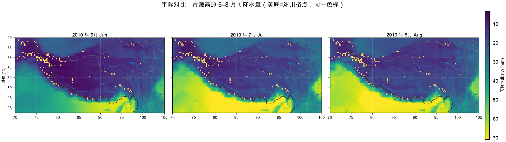
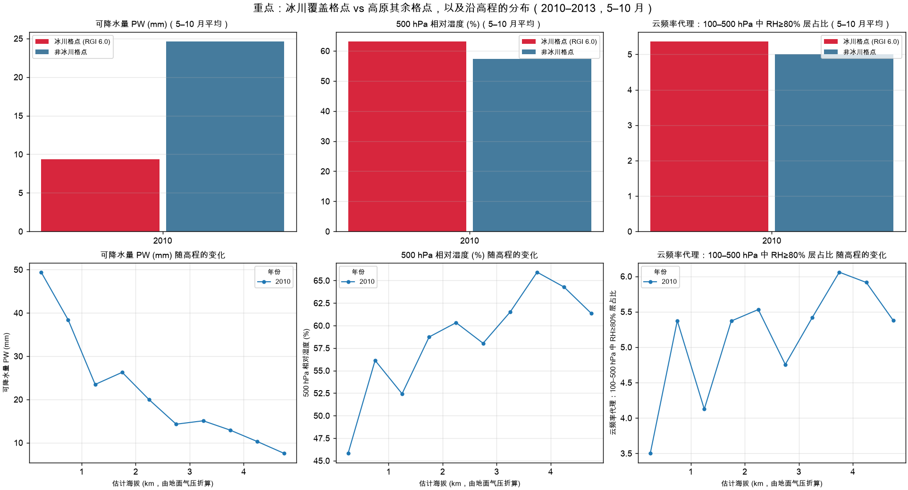
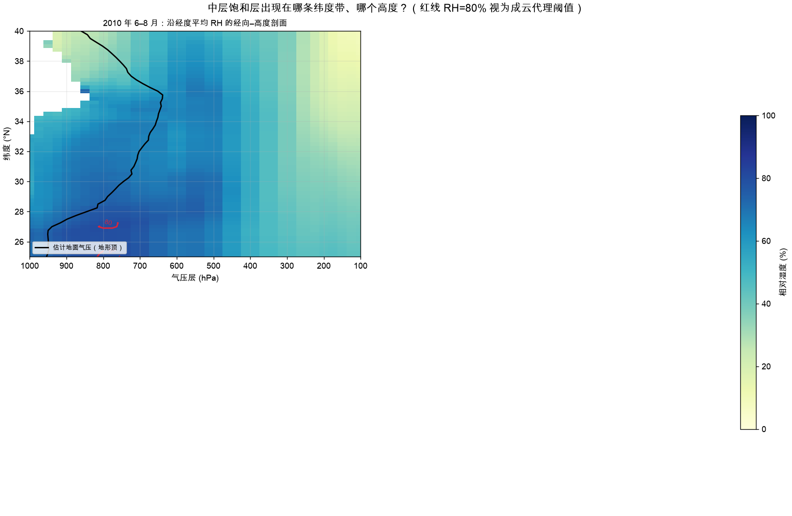
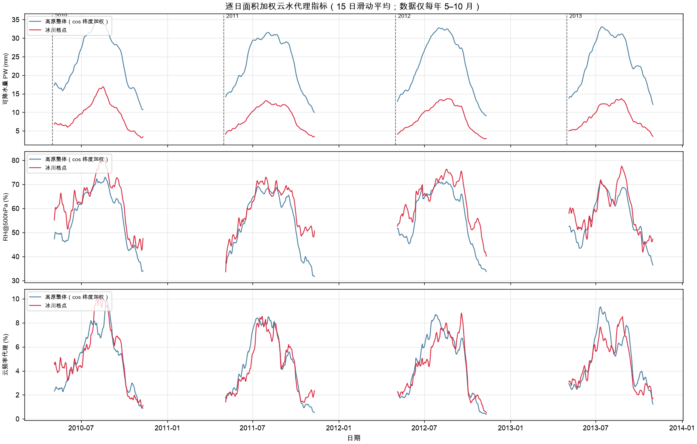
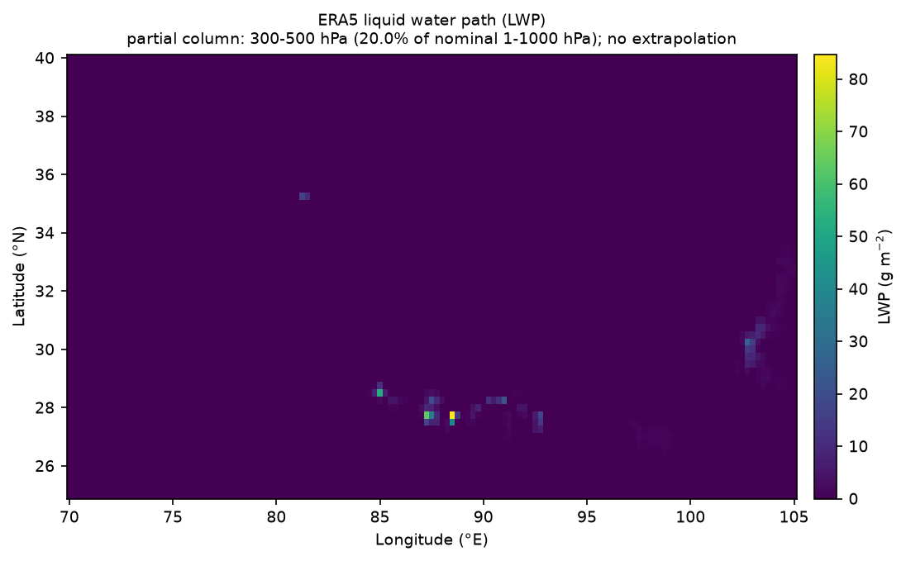
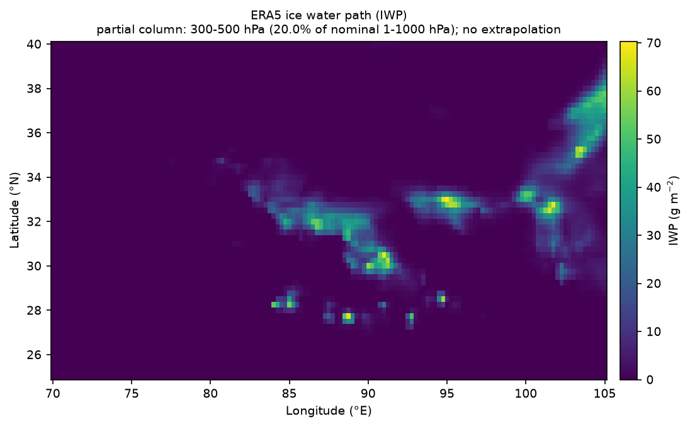
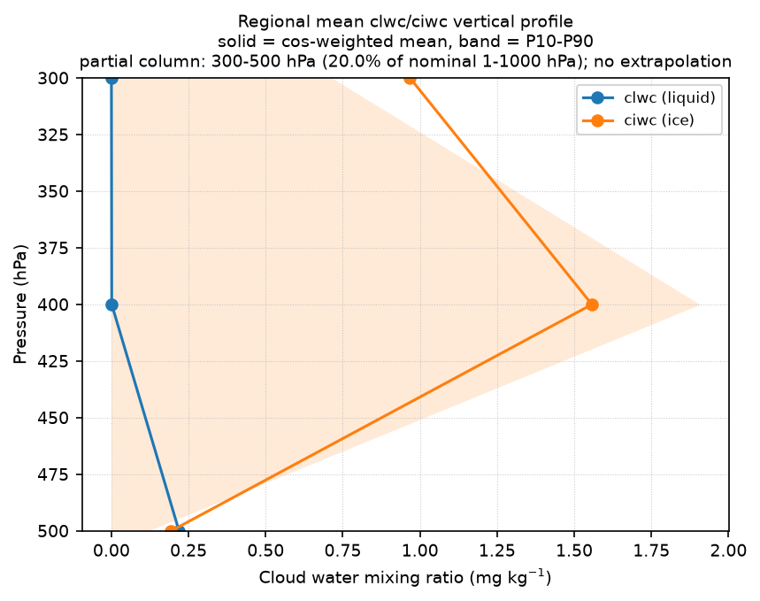
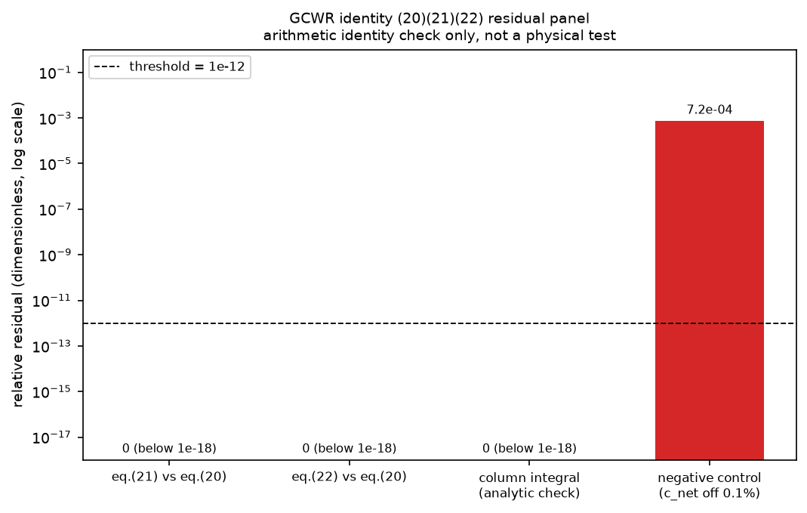

<div align="center">

# 🌀 Hydroweave

**Cloud Water Resources Toolkit for the Tibetan Plateau**

Turning "how much cloud water is there, where is it, how does it change, and how far can we trust it?"
into a computable, falsifiable model.

[](https://github.com/Neiyako/HydroWeave/actions/workflows/ci.yml)
[](https://www.python.org/)
[](LICENSE)
[](https://github.com/astral-sh/ruff)

[中文](README.md) · [**English**](README.en.md) · [📘 Onboarding](docs/ONBOARDING.md) · [📐 Design Notes](docs/DESIGN.md)

</div>

---

## 📖 What is this

**Hydroweave is a purpose-built experiment framework for Tibetan Plateau cloud water research.**

It decomposes a vague scientific question — *"how much cloud water is actually over the plateau?"* —
into independently verifiable stages. Each stage provides **mathematical definitions, empirical formulas,
error bounds, and empirical conclusions**, all tied together by a unified run manifest for reproducibility.

> **In one sentence: Hydroweave turns cloud water questions into computable, falsifiable models and delivers both figures and error bounds.**

### Why it exists

Rigorous cloud water assessment requires variables such as cloud liquid water (`clwc`) and
cloud ice water (`ciwc`), while standard ERA5 pressure-level data only provides `t / q / u / v`.
There are two wrong ways to react:

| ❌ Wrong approach | Consequence |
|---|---|
| Substituting precipitable water (PW) for cloud water | Systematic overestimation by orders of magnitude; conclusions void |
| Writing "waiting for data" into the roadmap | Project stalls, and what *could* be computed is hidden |

Hydroweave takes a third path: **declare the proxy explicitly, compute the proxy accurately,
and state the boundaries clearly** — while implementing the rigorous model completely so it can be
plugged in as soon as the data arrives.

---

## ✨ Features

| | Feature | Description |
|---|---|---|
| 🧮 | **Traceable formulas** | Every quantity has an explicit mathematical definition and discretization; formula numbers map back to code and literature |
| 🎯 | **Three-layer error analysis** | Numerical / calibration / proxy errors quantified separately — never a vague "5% error" |
| 🧪 | **Independent recomputation** | Recomputes via a separate code path; single-column PW relative error **0.0000%** |
| 🔁 | **Bit-level reproducibility** | Same config + same input ⇒ same artifacts; manifest records SHA-256 of every artifact |
| 🗺️ | **8 figure types** | Spatial fields, cross-sections, elevation binning, glacier contrast, time series — with basemap and projection correction |
| 🛡️ | **Falsifiability first** | When even the error *direction* is unknown, report `INSUFFICIENT_EVIDENCE` instead of a number |
| ⚙️ | **CI enforced** | GitHub Actions three-layer verification: lint + multi-version tests + end-to-end synthetic pipeline |

---

## 🧭 Architecture: five stages, one evidence chain

```text
① Mathematical basis   How quantities are defined, discretized, masked    → eda.py
      ▼
② Empirical formulas   Which quantities are computable under data limits   → proxy boundaries
      ▼
③ EDA & patterns       Yearly / monthly / glacier vs non-glacier / elevation
      │                 from fields to conclusions                        → eda.py + plot.py
      ▼
④ Error analysis       Numerical, calibration, and proxy errors separately → validate_real_eda.py
      ▼
⑤ Reproducibility      Same config + same input ⇒ same artifacts           → repro/manifest.py
```

**Why these five stages**: research conclusions rarely fail because of arithmetic — they fail because
**definitions were unclear, errors were unquantified, or reproducibility was not locked down**.
The five stages address exactly these three failure modes: ① and ② fix *what is being computed*,
④ quantifies *how wrong it is*, and ⑤ guarantees *others can recompute the same numbers*.

### Two parallel technical tracks

```text
Track A (runnable today): proxy indicator chain
    ERA5 t/q  →  PW / RH500 / CFRAC  →  EDA patterns  →  8 figure types
                 ↑ implemented, validated on real 2010–2013 volume

Track B (model ready, waiting for cloud water data): budget chain
    water terms  →  budget equations  →  GCWR / efficiency / renewal  →  error budget
                    ↑ implemented, regression-tested against published values;
                      pure algebraic layer, independent of data
```

Both tracks share the same conventions (unit chain, level ordering, terrain mask, area weighting).
When cloud water data arrives, Track B only needs **input substitution — no model restructuring**.

---

## 🛠️ Tech Stack

Implemented in **Python (≥3.11)**, oriented toward scientific computing and reproducible research:

<p>


</p>

| Concern | Stack | Responsibility |
|---|---|---|
| **Numerics** | `numpy` `xarray` `pandas` | Multi-dimensional arrays, labelled data, tabular processing |
| **Climate data I/O** | `netCDF4` `xarray` | ERA5 pressure-level NetCDF read/write, coordinates and units |
| **Chunked concurrency** | `dask[array]` `flox` | 2 TB volumes streamed in 10-day batches; never loaded in full |
| **Scientific plotting** | `matplotlib` `pyshp` | Fields, cross-sections, colour scales, basemap, projection |
| **Config & contract** | `PyYAML` `hashlib` | Single config entry, config hash, per-artifact SHA-256 fingerprints |
| **Quality** | `pytest` `ruff` `GitHub Actions` | 47 test cases, static analysis, three-job CI |

**Engineering conventions**

- Data is streamed in **10-day batches with 2 threads**, decoupling memory from volume size
- Every experimental convention comes from a single `config.yaml`; no machine-specific paths in code
- Artifacts are written to `.part` then atomically replaced — resumable, with failed dates recorded

---

## 📦 Project Structure

```text
Hydroweave/
│
├── README.md                    Chinese documentation
├── README.en.md                 English documentation (this file)
├── CHANGELOG.md                 Version history (Keep a Changelog format)
├── CONTRIBUTING.md              Contribution guidelines
├── CODE_OF_CONDUCT.md           Code of Conduct
├── CITATION.cff                 Citation metadata
├── pyproject.toml               Dependencies + ruff + pytest configuration
├── LICENSE                      MIT
│
├── docs/
│   ├── ONBOARDING.md            📘 Onboarding: formula ledger, error analysis, conventions
│   ├── DESIGN.md                📐 Design notes: why each convention was chosen
│   └── img/                     Documentation figures
│
├── experiments/tp_cloud_water/  Core experiment code ("what to compute")
│   ├── config.yaml              ⭐ Single config entry (region/years/levels/thresholds/hours)
│   ├── eda.py                   Proxies: column integral, RH, terrain mask, weighting, resume
│   ├── budget.py                Budget model: Eq. (1)–(32), including GCWR
│   ├── error_analysis.py        GCWR errors: first-order propagation, calibration, verdicts
│   ├── plot.py                  8 figure types: fields, sections, elevation, glacier, series
│   └── common.py                Config loading, catalog index, run dirs, manifest I/O
│
├── src/hydroweave/repro/        Reproducibility contract ("why it can be trusted")
│   └── manifest.py              Config hash / input fingerprint / atomic write / SHA-256
│
├── scripts/
│   ├── demo/make_tp_cloud_water_fixture.py   Synthetic fixture generator (no external drive)
│   ├── dev/validate_real_eda.py              🔍 Independent acceptance (adversarial, 10 criteria)
│   └── analysis/                             Thin CLI wrappers
│
├── tests/                       47 test cases
│   ├── test_cloud_water_budget.py            Budget algebra & error analysis (26)
│   ├── test_repro_manifest.py                Manifest mechanics (9)
│   ├── test_tp_cloud_water_experiment.py     Synthetic pipeline end-to-end (3)
│   └── test_tp_cloud_water_real.py           Real-volume contract (9, needs external drive)
│
├── .github/
│   ├── workflows/ci.yml         GitHub Actions: lint + test + repro
│   ├── ISSUE_TEMPLATE/          Issue templates (bug / science / feature)
│   └── PULL_REQUEST_TEMPLATE.md
│
└── data/                        Artifacts (not in Git; recorded by manifest)
    └── analysis/tp_cloud_water/runs/<run_id>/
        ├── yearly/              Monthly-mean NetCDF fields
        ├── tables/              Daily/monthly tables, read-problem log
        ├── figures/             8 figure types
        ├── summary/             EDA summary
        └── manifest.json        Run manifest
```

**One boundary to keep in mind when reading the tree**: `experiments/` holds *what to compute*,
`src/hydroweave/repro/` holds *why it can be trusted*, and `scripts/dev/` holds *who verifies it*.
They are separated so the verifier does not depend on the verified —
`validate_real_eda.py` deliberately **does not reuse** any computation function from `eda.py`.

---

## 🚀 Quick Start

### 1. Install

```bash
git clone https://github.com/Neiyako/HydroWeave.git
cd HydroWeave
python3 -m venv .venv
.venv/bin/python -m pip install -e '.[dev]'
```

### 2. Synthetic self-check (recommended — no 2 TB external drive needed)

```bash
# ① Generate a self-contained synthetic fixture (catalog, glacier mask, config)
python3 scripts/demo/make_tp_cloud_water_fixture.py /tmp/tp_fixture --days 3

# ② Run EDA: daily tables, monthly fields, manifest
PYTHONPATH=src:. .venv/bin/python -m experiments.tp_cloud_water.eda \
    --config /tmp/tp_fixture/config.yaml --run-id fixture

# ③ Run plotting: 8 figure types + EDA summary
PYTHONPATH=src:. .venv/bin/python -m experiments.tp_cloud_water.plot \
    --config /tmp/tp_fixture/config.yaml --run-id fixture
```

> Numbers from synthetic data **have no physical meaning**. The check validates directory structure,
> manifest mechanics, resume behaviour, and the plotting pipeline.

### 3. Real volume run

Requires the external ERA5 volume to be online with a catalog registered by the DBAS data layer
(read-only consumption).

```bash
PYTHONPATH=src:. .venv/bin/python experiments/tp_cloud_water/eda.py \
    --config experiments/tp_cloud_water/config.yaml --run-id tp-2010-2013

PYTHONPATH=src:. .venv/bin/python experiments/tp_cloud_water/plot.py \
    --config experiments/tp_cloud_water/config.yaml --run-id tp-2010-2013
```

⚠️ **EDA and plotting must share the same `--run-id`**, otherwise figures will be paired with the wrong fields.

### 4. Budget model (no data required)

```python
from experiments.tp_cloud_water import budget as B, error_analysis as E

t = B.BudgetTerms(
    qv_init=2.03e14, qv_final=2.03e14,      # vapor initial/final (kg)
    qh_init=1.14e13, qh_final=1.14e13,      # hydrometeor initial/final
    qv_in=2.05e16, qv_out=2.05e16,          # vapor boundary in/out
    qh_in=2.1e15, qh_out=1.9e15,            # hydrometeor boundary in/out
    rain_kg=6.58e15, duration_s=365 * B.SECONDS_PER_DAY,
)

rep = B.evaluate(t)                                              # all metrics in one dict
chk = B.sanity_check(rep)                                        # magnitude sanity check
sig = E.summarize(rep, E.TermSigma(qh_final=2e9, qh_out=1e9))    # error budget + verdict

print(f"GCWR = {rep['gcwr_kg']:.3e} kg")
print(f"Tv = {rep['Tv_days']:.1f} d, Th = {rep['Th_hours']:.1f} h")
print(f"verdict: {sig['verdict']}, dominant: {sig['dominant_source']}")
```

**The order cannot be inverted**: verify S7–S10 identities via `evaluate` first, then inspect the error
interval, and only then discuss conclusions.

---

## 🧮 Core Formulas at a Glance

> Full symbol conventions, code locations, and source references are in [📘 Onboarding §2](docs/ONBOARDING.md).

### Track A: proxy indicators (computable with current data)

```text
Precipitable water  PW = (1/g) ∫ q dp ≈ Σ_i q_i · w_i / g            [mm]
Relative humidity   RH = 100 · e / e_s,  e = p·q/(0.622+q),  e_s via Magnus (water)
Cloud frequency     CFRAC = n(layers with RH≥80%) / n(valid layers)
Terrain mask        |q[i+1] − q[i]| ≤ atol + rtol·|q[i]|   constant-run search from bottom
Area weighting      W(φ) = cos φ / Σ cos φ
```

### Track B: budget model (after Cai Miao's PhD thesis, Ch. 2)

```text
Budget eqs   Qv,final − Qv,initial = Qv,in − Qv,out + E − C_net          (1)
             Qh,final − Qh,initial = Qh,in − Qh,out − R + C_net          (2)
             Qm,final − Qm,initial = Qm,in − Qm,out + E − R              (3)

Core metric  GCWR = GQh − R                                              (20)
                  = Qh,final + Qh,out                                    (21)
                  = Qh,initial + Qh,in + C_net − R                       (22)

Efficiency   Em = R/GQm,  Eh = R/GQh,  P = total condensation/GQv         (17)(18)
Renewal      Tv = Qv,mean/(R/T),  Th = Qh,mean/(R/T)                     (19)
```

### ⚠️ Two pitfalls you must know

| Pitfall | Consequence | Correct approach |
|---|---|---|
| Eq. (16) `GQm = GQv + GQh` holds only for **instantaneous storage** | Cumulative quantities double-count net condensation — **≈60% overestimate** measured | `GQm = GQv + GQh − C_net`, and compute `GQm` independently via Eq. (15) |
| Sub-terrain filled layers carry no missing-value flag | Filled layers are **21.7%** of all layers; without masking PW is overstated by ≈1/5 | Equal-run detection: search for the surface layer from the bottom up |

---

## 📊 Error Analysis

Errors must be **decomposed into layers**. Reporting a vague "5% error" carries no information.

### Three error layers

| Layer | Sources | Quantification | Measured |
|---|---|---|---|
| **① Numerical** | Discretization, implementation, alignment | Independent recomputation | Relative error **0.0000%** |
| **② Calibration** | Terrain fill, phase, synoptic hours, threshold | Direction + magnitude | Filled layers **21.7%** |
| **③ Proxy** | Proxy ≠ true physical quantity | Direction known; scope bounded | One-directional bias |

### First-order propagation for GCWR

GCWR is a **linear combination** of terms, so first-order (Gaussian) propagation is **exact**:

```text
GCWR = Qh,final + Qh,out
∂GCWR/∂Qh,final = 1,  ∂GCWR/∂Qh,out = 1,  all other derivatives = 0
σ²_GCWR = σ²(Qh,final) + σ²(Qh,out)
```

> 💡 **Counter-intuitive but crucial**: observation errors in precipitation, initial values, and
> boundary inflow have **zero first-order effect** on GCWR (they are absorbed by the back-calculation
> or cancel out). Therefore **improving precipitation observations will not reduce GCWR uncertainty** —
> only accurate hydrometeor end-state fields and boundary outflow can. This conclusion directly sets
> the research priority.

### Verdict thresholds (fixed before use)

| Relative 1σ | Verdict | Meaning |
|---|---|---|
| < 20% | `CONCLUSIVE` | Supports quantitative conclusions |
| 20% – 50% | `CONDITIONAL` | Supports relative / qualitative conclusions only |
| ≥ 50% | `INSUFFICIENT_EVIDENCE` | Interval only; no magnitude claims |

### Ten acceptance criteria

| ID | Criterion | Measured |
|---|---|---|
| S1–S2 | catalog files present; exactly 184 days per year, q/t paired | PASS (736 days) |
| S3 | Sampled-day quantities physically plausible | PASS |
| S4 | Independent single-column PW recomputation, relative error ≤0.5% | PASS (**0.0000%**) |
| S5 | Bit-identical to the legacy implementation | PASS (max abs diff = 0) |
| S6 | Manifest, daily tables, figures, summary all complete | PASS |
| S7–S10 | GCWR three-way identity, `GQm` not mis-summed, storage identity, boundary decomposition | Locked by unit tests |

**Final verdict: PASS** (measured 2026-11-03)

---

## 🗺️ Example Figures

### Interannual comparison (shared colour scale)



### Glacier vs non-glacier + elevation binning



### Meridional–pressure cross-section



### Daily time series



**Plotting conventions**: three fixed colormaps, colour scale shared across years, 1%–99% percentile
bounds, `aspect = 1/cos φ` projection correction, gold glacier overlay, nothing plotted below terrain,
DPI 130.

### Real `clwc/ciwc` cloud water columns (three-repo e2e, 2026-11-04)

Real ERA5 cloud-water mixing ratios, delivered through ResearchDataHub → DBAS catalog →
`experiments/cloud_water_strict/` (`run-id=real-catalog-20240101`, 2024-01-01 00Z,
300/400/500 hPa, Tibetan Plateau 25–40°N/70–105°E).





LWP = ∫(clwc/g)dp, IWP = ∫(ciwc/g)dp (layer-midpoint trapezoid, cosφ area weighting):
ice dominates in this sample (area-mean IWP 2.18 g·m⁻² vs LWP 0.11 g·m⁻²), consistent with
the mid/upper troposphere over the plateau in winter.



Model self-check (identities (20)(21)(22), analytic column integral, 0.1% negative control):



**Read the caveat with the figures**: this is a single-time, **partial column** (200 hPa of the
nominal 1000 hPa column, no extrapolation), not a full-column LWP/IWP and not a climatology.
Overall verdict is `INSUFFICIENT_EVIDENCE` (identity/integration/units/partial-column: PASS;
GCWR budget closure: NOT_RUN, missing P/E/boundary fluxes). See
[`docs/CLOUD_WATER_VERIFICATION.md`](docs/CLOUD_WATER_VERIFICATION.md).

---

## ✅ Findings

> From the real 2010–2013 volume (736 warm-season days), graded by strength of evidence.

### Directly usable: multi-year warm-season means

| Month | PW (mm) | Glacier PW (mm) | RH500 (%) | CFRAC (%) |
|---|---|---|---|---|
| May | 16.6 | 5.9 | 47.0 | 2.6 |
| Jun | 24.9 | 8.8 | 59.9 | 5.3 |
| Jul | 31.7 | 12.3 | 68.3 | 7.9 |
| Aug | 30.9 | 13.2 | 67.1 | 6.9 |
| Sep | 24.3 | 9.1 | 57.3 | 4.7 |
| Oct | 14.2 | 4.4 | 39.7 | 1.7 |

**Three findings (graded by evidence strength)**

1. **Single-peaked seasonal cycle with a midsummer maximum** — *data fact*. PW and CFRAC peak together
   in July–August; "coincides with" is not "caused by" — causation requires budget and circulation diagnosis.
2. **CFRAC is small and interannually stable (4.7–5.0%)** — *data fact*. Because RH is biased low in one
   direction, absolute values should be read as a **lower bound**; with only 4 years, **no trend can be claimed**.
3. **Glacier-grid PW is about one third of the plateau mean** (9 mm vs 24 mm) — *observed fact,
   mechanism unverified*. This contradicts the naive intuition that glacier areas are moisture-rich, and
   the direction is stable across four years. Candidate explanations remain unconfirmed —
   **moisture sources cannot be inferred from the PW field alone**.

### Not yet established

**GCWR: `INSUFFICIENT_EVIDENCE`** — this volume lacks `clwc/ciwc`, so the 3-D hydrometeor field cannot be
constructed. The model is ready and can be connected once the data arrives.

---

## 🧪 Testing & CI

### Local verification

```bash
PYTHONPATH=src:. python3 -m pytest -q                    # 38 passed, 9 skipped
PYTHONPATH=src:. python3 -m pytest -m real -q            # real volume (skips if offline)
python3 scripts/dev/validate_real_eda.py                 # adversarial acceptance (needs drive)
ruff check .                                             # code quality
```

**The three commands validate different layers and cannot substitute for one another**:

| Command | Validates | Passing does NOT mean |
|---|---|---|
| `pytest -q` | Code mechanics intact | ❌ Physically correct |
| `pytest -m real` | Real-data contract holds | ❌ Conclusions trustworthy |
| `validate_real_eda.py` | Conclusions survive recomputation | — |

### GitHub Actions

[`.github/workflows/ci.yml`](.github/workflows/ci.yml) runs three jobs:

| Job | Content | Trigger |
|---|---|---|
| **Lint** | `ruff check` static analysis (rule set in `pyproject.toml`) | push / PR |
| **Test** | Matrix over Python 3.11 & 3.12, 47 test cases | push / PR |
| **Repro** | End-to-end synthetic pipeline: fixture → EDA → plot → manifest fingerprint check | push / PR |

Real-volume tests are **not** executed in CI (they require a 2 TB external drive). `-m real` skips
automatically and is explicitly recorded as **NOT_RUN** — **skipped is not passed**.

---

## 🤝 Contributing

Issues and pull requests are welcome!

- Full process: [CONTRIBUTING.md](CONTRIBUTING.md)
- Participation implies agreement with [CODE_OF_CONDUCT.md](CODE_OF_CONDUCT.md)
- **Challenges to scientific conclusions are the most welcome feedback** — please use the
  [science discussion template](https://github.com/Neiyako/HydroWeave/issues/new/choose) with your derivation

Before submitting, make sure:

```bash
ruff check .                             # static analysis passes
PYTHONPATH=src:. python3 -m pytest -q     # tests pass
```

For new experiments, follow the standard procedure in
[📘 Onboarding §4.6](docs/ONBOARDING.md): add a config parameter → implement with a formula-source
citation → add unit tests (including counter-examples) → run the synthetic pipeline → run the real
volume → update documentation.

**Code conventions**: one responsibility per file; `experiments/` holds *what to compute*, `repro/`
holds *why it can be trusted*, `dev/` holds *who verifies it*. Never silently modify data to force
an equation to close.

---

## 📚 References

1. **Cai Miao**. *Evaluation of China's airborne cloud water resources and precipitation efficiency* [D].
   PhD thesis. *Primary source for the budget model (Eq. 1–32), Chapter 2.*
2. **Li Ying, Su Fengge, Tang Qiuhong, et al.** Moisture sources of precipitation in major river basins
   of the Tibetan Plateau [J]. *Scientia Sinica Terrae*, 2022, 52(7): 1328–1344.
   [DOI: 10.1360/SSTe-2021-0217](https://doi.org/10.1360/SSTe-2021-0217)
   *Moisture source tracking — a different framework from GCWR; not substituted into the budget equations.*

---

## 📌 Citation

If Hydroweave helps your research, please cite:

```bibtex
@software{hydroweave2026,
  title   = {Hydroweave: A Tibetan Plateau Cloud Water Resources Toolkit},
  author  = {Neiyako},
  year    = {2026},
  version = {1.0.0},
  url     = {https://github.com/Neiyako/HydroWeave},
  license = {MIT}
}
```

Citation metadata is provided via [CITATION.cff](CITATION.cff); GitHub generates APA / BibTeX
automatically. If you use specific budget-model formulas, please also cite reference 1 above.

---

## ⚖️ Scope & Disclaimer

**In scope**: mathematical model construction and implementation, code computation, error analysis, plotting.

**Out of scope**: data acquisition and gap filling (data layer), bit-level data verification,
moisture source tracking.

**Data**: raw ERA5 data is not distributed with this repository and is only read from a local volume
in read-only mode. Reproducing experiments requires your own copy of the same source data; data
licensing follows the publisher's terms.

**Using the results**: `GCWR` is a **coarse estimate** of cloud water resources; only a fraction is
exploitable by weather modification and it is **not equal to exploitable water resources**. When citing
absolute magnitudes, always quote the error interval and threshold conditions together.

---

## 📄 License

[MIT License](LICENSE) © 2026 qiu-yuyi

<div align="center">

**[⬆ Back to top](#-hydroweave)** · [📘 Onboarding](docs/ONBOARDING.md) · [中文](README.md)

</div>
