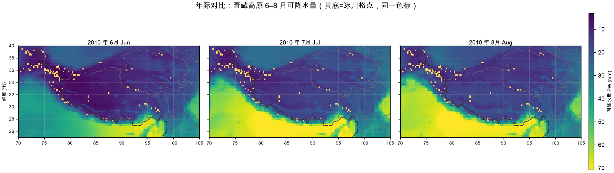

# Hydroweave — 科研实验与绘图层

Hydroweave 是 [DBAS](https://github.com/Neiyako/HydroWeave)（科研数据资产管理与任务编排系统）的**下游实验仓**：
它不管理数据卷，也不重新发明 catalog，只负责把 DBAS 索引好的数据变成**可复现的科研结果与图件**。

> 一句话分工：**DBAS 管数据资产，Hydroweave 管实验口径与出图。**

```text
外接 ERA5 卷（只读，DBAS 登记）
        │  volume_id + rel_path
        ▼
DBAS catalog（data/catalog.db）—— 卷 / 文件 / 数据集 / 任务状态
        │  只读查询：dataset_id + volume_id → 文件清单与逻辑指纹
        ▼
Hydroweave（本仓）
  experiments/<name>/   每个实验：config.yaml + 计算 + 制图
  src/hydroweave/repro/ 运行清单：配置哈希 / 输入指纹 / Git / 包版本 / 产物 SHA-256
        │
        ▼
data/analysis/<experiment>/runs/<run_id>/
  manifest.json · yearly/ · tables/ · figures/ · summary/
```

## 为什么不放在 DBAS 里

DBAS 的主产品边界是**数据库管理与任务编排**。把实验和绘图留在主仓，会让一个数据管理系统的提交历史被一次性分析脚本淹没，
也让"数据口径"和"物理口径"两种责任混在一起。拆开后：

- DBAS 只对**资产是否完整、可定位、可恢复**负责；
- Hydroweave 只对**实验口径是否可复现、图件是否可追溯**负责，并且每个 run 都留下 `manifest.json`。

## 现有实验

| 实验 | 内容 | 入口 |
|---|---|---|
| [`tp_cloud_water`](experiments/tp_cloud_water/) | 青藏高原云水资源代理指标（PW / RH500 / CFRAC）分年 EDA 与制图 | `experiments/tp_cloud_water/{eda,plot}.py` |



> 当前卷只有 `t/q/u/v`，PW / RH500 / CFRAC 是**代理指标**，不是真实云水含量。
> 严格云水需要 `clwc/ciwc` 或总云量场，物理口径见 [eda.py](experiments/tp_cloud_water/eda.py) 与
> [dbas-core](https://github.com/Neiyako/dbas-core) 的 `cloud_water_proxy` 模块。

## 快速开始

### 1. 前置：DBAS 侧先把数据索引好

```bash
# 在 DBAS 仓库里执行
dbas volume register /Volumes/Untitled --id era5hd
dbas scan --volume era5hd --mode inventory --enqueue-metadata
dbas scan --volume era5hd --mode metadata
dbas dataset assign --volume era5hd
```

Hydroweave 通过 `config.yaml` 里的 `catalog:` / `volume_id:` / `dataset_id:` 只读查询，
**不写 catalog，也不写原始卷**。

### 2. 安装

```bash
cd ~/Desktop/Hydroweave
python3 -m venv .venv
.venv/bin/python -m pip install -e '.[dev]'
```

### 3. 合成数据自检（不联网、不碰外接盘）

```bash
.venv/bin/python scripts/demo/make_tp_cloud_water_fixture.py /tmp/tp_fixture --days 3
PYTHONPATH=src:. .venv/bin/python -m experiments.tp_cloud_water.eda  --config /tmp/tp_fixture/config.yaml --run-id fixture
PYTHONPATH=src:. .venv/bin/python -m experiments.tp_cloud_water.plot --config /tmp/tp_fixture/config.yaml --run-id fixture
```

### 4. 真实卷运行

```bash
# 先把主仓的 catalog 路径配到自己的 config.yaml（或用 --config 指过去）
PYTHONPATH=src:. .venv/bin/python experiments/tp_cloud_water/eda.py \
    --config experiments/tp_cloud_water/config.yaml --run-id tp-2010-2013
PYTHONPATH=src:. .venv/bin/python experiments/tp_cloud_water/plot.py \
    --config experiments/tp_cloud_water/config.yaml --run-id tp-2010-2013
```

`--run-id` 省略时取 `run-<配置哈希>`；EDA 与制图必须使用同一个 run-id。

## 可复现契约

- **一个配置入口**：`config.yaml` 决定 catalog、卷、年份、区域、时次、阈值与输出目录，代码里没有机器专属路径；
- **一个 run 目录**：产物全部落在 `data/analysis/<experiment>/runs/<run_id>/`，不散落；
- **一份运行清单**：`manifest.json` 记录配置哈希、输入逻辑指纹（卷 ID + 相对路径 + 大小 + mtime）、Git revision、关键包版本、完成年份、失败日期和每个产物的 SHA-256；
- **断点续跑**：年度/批次产物先写 `.part` 再原子替换；已完成的年份直接跳过；
- **拒绝混放**：配置哈希或输入指纹变化时，同 run-id 直接报错，必须换 run-id 或显式 `--force`。

> 复现边界要说清楚：`manifest.json` 的输入指纹是**逻辑指纹**，不是比特级 SHA-256。
> 需要比特级归档证据时，用 DBAS 的 `dbas checksum` 分批生成；一个 manifest 不能冒充物理验证。

## 测试

```bash
PYTHONPATH=src:. .venv/bin/python -m pytest -q          # 合成链路 + 运行清单
PYTHONPATH=src:. .venv/bin/python -m pytest -m real -q  # 真实卷（不在线自动 skip）
```

- `tests/test_tp_cloud_water_experiment.py`：fixture → EDA → manifest → 续跑 → 制图全链路，含配置不一致拒绝与缺 mask 明确失败；
- `tests/test_tp_cloud_water_real.py`：真实卷 9 个用例（catalog 与盘一致、736 天覆盖、单日物理区间、单柱 PW 独立重算、产物回归）；
- `tests/test_repro_manifest.py`：哈希稳定、指纹、原子写。

独立验收（不经过实验代码重算，避免自证）：

```bash
.venv/bin/python scripts/dev/validate_real_eda.py
```

六条硬标准执行前固定在脚本 `STANDARDS` 里，报告写到 `data/analysis/tp_cloud_water/validation/real_eda_check.md`，
判定只有 PASS / CONDITIONAL_PASS / FAIL。2026-11-03 实测：六项全 PASS，单柱独立重算相对误差 0.0000%，
4 年 × 4 变量 max abs diff = 0。

## 目录结构

```text
src/hydroweave/repro/      运行清单（配置哈希 / 输入指纹 / 原子写 / 产物指纹）
experiments/               每个实验一个子目录，自带 config + 计算 + 制图 + README
scripts/analysis/          实验命令行的薄包装
scripts/demo/              合成试验台生成器（不依赖外接盘）
scripts/dev/               真实卷独立验收
tests/                     合成数据测试（默认不联网）
docs/img/                  README 例图
data/                      实验产物（不入 Git）
```

## 与 DBAS 的版本绑定

`pyproject.toml` 把 `dbas-core` 钉在固定 commit，避免上游解析口径漂移。升级流程：
本地验证 → 改 commit → 重装 → 更新依赖快照 → 重跑 `-m real` 与独立验收。

## 许可

见 [LICENSE](LICENSE)。
