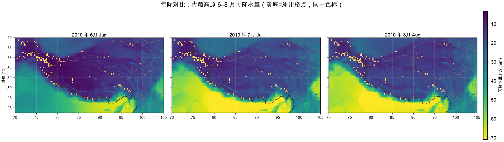

> **文档定位**：这是 Hydroweave 的**设计说明书**——逐节解释每个数学口径"为什么这样取"、
> 误差如何分层、验收标准如何设计，以及 2010–2013 真实卷的实测结论。
>
> - 想快速上手、查公式总账 → [ONBOARDING.md](ONBOARDING.md)
> - 想了解项目概况与技术栈 → [README](../README.md)
> - 想知道**为什么这么设计** → 就是本文
>
> 本文与 README 的公式口径完全一致，细节以本文为准。

---

# Hydroweave — 青藏高原云水资源实验体系

Hydroweave 是一套**为青藏高原云水资源课题自行设计的实验体系**：它把"云水有多少、在哪、怎么变、能信到什么程度"
拆成可独立检验的实验环节，每一环都给出**数学定义、经验公式、误差边界与实证结论**，并用统一的运行清单保证结论可复现。

**本仓承担的工作范围是四条：数学模型的建立与实现、代码计算、误差分析、绘图出图。**
数据卷里有哪些变量属于数据侧条件，不在本仓职责内——本仓的做法是在给定变量的约束下
把能算的算准、把误差的方向和量级说清，而不是把"等某个变量"写成待办。

它不是一个数据管理工具的附属模块，也不是某一套脚本的集合。判断它是否成立的标准只有三条：
**公式写得出来、误差算得清楚、结论经得起独立重算。**

> 一句话定位：**Hydroweave 负责把云水资源问题变成可计算、可证伪的模型，并交付图与误差边界。**

> 📘 **第一次接手请先读 [docs/ONBOARDING.md](../docs/ONBOARDING.md)**：上手文档把全部公式、
> 来源依据、误差分析、实验规范、绘图规范与已有结论收在一处，读完即可上手。
> 本 README 侧重"为什么这样设计"，ONBOARDING 侧重"具体怎么做、公式从哪来"。

## 体系结构：五个环节，一条证据链

实验体系由五个环节串联，每个环节都对应本仓的具体代码与产物，不是概念图。

```text
① 数学原理        物理量怎么定义、积分怎么离散化、掩膜怎么判定
      │           → experiments/tp_cloud_water/eda.py
      ▼
② 经验公式        本套数据的约束下，哪些量可算、哪些只能取代理
      │           → 代理边界见 §2；可用性审计 proxy_audit.md（运行产物）
      ▼
③ EDA 与规律分析  分年/分月/冰川-非冰川/高程分层，从场到结论
      │           → eda.py（场）+ plot.py（规律）+ summary/*.md
      ▼
④ 误差分析        数值误差、口径误差、代理误差三层拆开算
      │           → scripts/dev/validate_real_eda.py（六条硬标准）
      ▼
⑤ 可复现契约      同一配置 + 同一输入 ⇒ 同一产物，逐比特可验
                  → src/hydroweave/repro/manifest.py
```

**为什么是这五个环节**：科研结论失效，绝大多数不是算错，而是**口径没定义清、误差没量化、复现没锁住**。
五个环节分别堵住这三类失效——①②固定"我在算什么"，④量化"我错多少"，⑤保证"别人能重算出同样的数"。

## 一、数学原理

以下公式全部是本仓代码的真实口径，改动会被 `config_hash` 捕获并拒绝混放。

**符号约定**（全文一致，避免歧义）：

| 符号 | 含义 | 单位 |
|---|---|---|
| `q` | 比湿（水汽质量 / 湿空气质量） | kg·kg⁻¹ |
| `p` | 气压，气压层本身的值 | Pa（读入后由 hPa ×100 换算） |
| `p_i` | 第 i 个气压层的压力，i 自顶向下递增 | Pa |
| `w_i` | 第 i 层的积分权重（层厚导数） | Pa |
| `t_c` | 摄氏温度，`t_c = T − 273.15` | ℃ |
| `e` / `e_s` | 实际水汽压 / 饱和水汽压 | Pa |
| `φ` | 纬度 | ° |
| `sp` | 反演得到的地面气压 | hPa |
| `g` | 重力加速度，取 `9.80665` | m·s⁻² |
| `RH` | 相对湿度 | % |
| `RH_cloud` | 成云阈值，默认 80 | % |

单位链的关键恒等式：`1 kg·m⁻² 水柱 ≡ 1 mm` 水深。正因为如此，`PW` 的积分结果可直接读作毫米，
不需要额外换算——这也是 `∫q dp/g` 成立的前提。

### 1.1 可降水量：梯形积分离散

连续定义与离散实现：

```text
连续：  PW = (1/g) ∫ q dp          [kg·m⁻² ≡ mm]
```

代码按 37 个气压层做**梯形积分**（[`eda.py` 的 `trapezoid_weights`](../experiments/tp_cloud_water/eda.py#L101-L107)），
层界面取相邻层中点，两端各取半个层厚：

| 位置 | 权重 w_i |
|---|---|
| 顶层（i=0） | (p₁ − p₀)/2 |
| 中间层 | (p_{i+1} − p_{i−1})/2 |
| 底层（i=n−1） | (p_{n−1} − p_{n−2})/2 |

于是 `PW = Σ_i q_i · w_i / g`，其中 `g = 9.80665 m·s⁻²`，气压统一换算为 Pa。

**为什么用梯形而不是矩形**：37 层在近地面间隔仅十几 hPa、高层可达上百 hPa，
矩形累加在层厚突变处会产生系统性偏差；梯形权重把误差降到二阶。若改用指数坐标的
精确解析积分，需假设 q 随 ln p 线性——本卷近地面 q 变化剧烈，该假设不成立，故不采用。

### 1.2 相对湿度：Magnus 经验公式

由比湿反演水汽压、再求相对湿度：

```text
水汽压：  e = p · q / (0.622 + q)
饱和水汽压（水面）：  e_s = 611.2 · exp(17.67·t_c / (t_c + 243.5))    t_c 单位 ℃
相对湿度：  RH = 100 · e / e_s        （裁剪到 [0, 300]%）
```

其中 `0.622 = R_d/R_v` 是干湿空气气体常数比，这是比湿与混合比近似关系带来的常数。

**这里刻意选的是"水面"系数**（`17.67 / 243.5`），而不是冰面系数（`21.875 / 265.5`）。
后果必须写清楚：**高原高空温度常低于 −20 ℃，用水面饱和水汽压会让分母偏大、RH 系统性偏低。**
这一条是已知偏差，不是 bug——修正它需要区分相态，而本卷没有 `clwc/ciwc` 可供判相（见 §2）。

偏差的方向可以定性地定下来：在 `t_c < 0` 时冰面 `e_s` 低于水面 `e_s`，二者之差随温度下降单调扩大
（−10 ℃ 约差 10%、−20 ℃ 约差 20% 量级），因此 RH 被系统性低估的幅度随高度增大。
它对本实验结论的影响是**单向的**：`RH500` 与 `CFRAC` 都偏保守，§3.5 报的 CFRAC 4.7–5.0%
应理解为**下限**，真实云发生频率只会更高，不会更低。方向已知的偏差比方向未知的偏差有用得多——
它允许我们给出"结论不会因这个偏差而反转"的判断。

三个施加于本式的假设及违背后果：

| 假设 | 何时不成立 | 后果 |
|---|---|---|
| 冰相忽略（只用水面饱和式） | `t_c < 0` 的高空层 | RH、CFRAC 系统性偏低（单向） |
| 比湿按混合比近似处理 | 极湿环境 `q → 0.04` 量级 | 分母 `0.622+q` 引入 <1% 偏差 |
| Magnus 系数在 −40～50 ℃ 内有效 | 超出该温区 | 经验式外推，置信度下降 |

### 1.3 地形掩膜：等值连段的几何判定

ERA5 气压层文件里，**地形以下的气压层被地面值填充，且不带缺测标记**。
直接对全部 37 层积分会把"岩石里的假空气"也算进 PW——这是这套数据最致命的口径陷阱。

本仓的反演方法是"**自最底层向上找等值连段**"（[`sub_ground_mask`](../experiments/tp_cloud_water/eda.py#L89-L98)）：

```text
判定相邻层相等：|q[i+1] − q[i]| ≤ atol + rtol·|q[i]|      atol=1e-6, rtol=1e-3
从最底层向上累积求"连续相等"的布尔链，取链的末端索引作为地面层
地面层及以下 ⇒ 无效（置 NaN，不计入积分）
```

**为什么要带容差 `rtol=1e-3`**：数据以 int16 打包缩放存储，数学上相等的填充值经解码后
可能有末位差异，严格 `==` 会漏判。容差取 1e-3 是通过真实数据标定的：更小会漏判、
更大会把真实的大气弱梯度误判成填充。

这个判定同时**免费给出了地面气压** `surf_p`，后续高程折算直接复用（见 §3.2），无需额外的 `sp` 变量。

### 1.4 面积加权：cos φ 权重

高原窗口 25–40°N，纬度跨度导致格点面积不等：

```text
权重  W(φ) = cos(φ) / Σ cos(φ)      对经度不变、只随纬度变化
区域均值  <x> = Σ W·x / Σ W         （仅在有效格点上求和后归一化）
```

若改用简单的算术平均，高纬格点会被系统性高估——在本窗口内这个偏差可达数个百分点，
量级与年际差异相当，足以淹没真实信号。

### 1.5 云频率代理：阈值面积比

```text
CFRAC = ( 100–500 hPa 内 RH ≥ RH_cloud 的层数 ) / ( 该层带内有效层数 )
默认 RH_cloud = 80%
```

用**有效层数**做分母（而非固定 37 层或总层数），是因为地形掩膜后每个格点剩余层数不同。
分母选错会让高原腹地（剩余层少）与边缘（剩余层多）不可比。

> 代码位置：[`compute_day`](../experiments/tp_cloud_water/eda.py#L110-L139)

### 1.6 综合模型：云水资源收支（蔡淼体系）

§1.1–§1.5 的三个代理量只描述「水汽有多少、可能成云多少」。**严格意义的云水资源
必须走水物质收支**，本节给出完整可计算模型，实现在
[`budget.py`](../experiments/tp_cloud_water/budget.py)。

**控制体定义**：区域 (X,Y) × 自地面到对流层顶 (Z)，时段 [0,T]。
所有分项都是该控制体内该时段的**累计质量（kg）**，不是某一时刻的柱含量。
这是与 §1.1 的 PW 最根本的区别——PW 是瞬时储量，GCWR 是收支余量。

**三条收支方程**（论文式 1–3）：

```text
水汽：  Qv,终 − Qv,初 = Qv,入 − Qv,出 + 地面蒸发 − 净凝结     (1)
水凝物：Qh,终 − Qh,初 = Qh,入 − Qh,出 − 降水   + 净凝结     (2)
总物质：Qm,终 − Qm,初 = Qm,入 − Qm,出 + 地面蒸发 − 降水     (3)
```

三条方程中，只有净凝结和地面蒸发是未知量——其余各分量都能从三维场和风场算出，
因此用 (2) 反算净凝结、用 (3) 反算地面蒸发：

```text
净凝结  C_net = Qh,终 − Qh,初 − Qh,入 + Qh,出 + 降水        (10)
地面蒸发 E     = Qm,终 − Qm,初 − Qm,入 + Qm,出 + 降水        (12)
```

**总量与效率**（论文式 13–19）：

```text
GQv = Qv,初 + Qv,入 + E = Qv,终 + Qv,出 + C_net      (13)
GQh = Qh,初 + Qh,入 + C_net = Qh,终 + Qh,出 + 降水    (14)
GQm = Qm,初 + Qm,入 + E = Qm,终 + Qm,出 + 降水        (15)
Em = 降水/GQm      Eh = 降水/GQh      P = 总凝结/GQv   (17)(18)
Tv = Qv,平均/(降水/T)    Th = Qh,平均/(降水/T)        (19)
```

**GCWR（空中留存云水量）**是论文的核心指标，有三种写法，代码必须同时算并交叉核对：

```text
GCWR = GQh − 降水                     (20)  原始定义
     = Qh,终 + Qh,出                  (21)  终端核算
     = Qh,初 + Qh,入 + C_net − 降水    (22)  初始核算
```

> **实现陷阱（本仓实测踩到）**：式 (16) `GQm = GQv + GQh` 说的是**瞬时库存**，
> 累计通量下**不成立**——净凝结在 GQv 里是汇、在 GQh 里是源，相加会重复计入一次。
> 在合成试算中，按 `GQv + GQh` 计算 GQm 会使结果比正确值高约 60%。
> 正确关系是 `GQm = GQv + GQh − C_net`，且 GQm 必须走式 (15) 独立核算。
> 验收脚本对此设了单独标准（见 §4.6）。

**边界平流**（论文 §2.2）。对每个边界面、每个层、每个时步取带符号质量：

```text
ΔM = ρ · q · u_n · ΔS · Δt             u_n 以指向控制体外为正      (23)
输出 = Σ max(ΔM, 0)        输入 = Σ max(−ΔM, 0)                  (24)(25)
```

**降水累计**：1 mm = 1 kg·m⁻²，故 `GR = Σ Σ M_i·P_{i,n}·A_i`（式 26）。再分析中「自预报起点累计」的降水变量**必须先差分还原单步降水**，
遇到负差分先查累计周期重置，**不得直接置零**。

**为什么不能用柱云液水代替 GCWR**：柱含量是瞬时存量，且常不含雨雪霰等空中降水粒子；
GCWR 是含初末存量、边界输送、净凝结与降水的时空收支量。二者不可互换。

**与李颖等（2022）的边界**：水汽来源追踪（WAM-2，回答"水从哪来"）与 GCWR（回答
"空中留了多少"）是两套不同框架，**来源贡献率不代入收支公式**，只作机理解释的背景。

**量级体检**（[`sanity_check`](../experiments/tp_cloud_water/budget.py)）。恒等式只能证明
代数没写错，**证明不了分项是否来自同一控制体**。以论文 2011 年全国评估为参照
（水汽瞬时平均 2.03×10¹⁴ kg、水凝物 1.14×10¹³ kg、年降水 6.58×10¹⁵ kg），
应得 `Tv≈11 天`、`Th≈15 小时`、`Eh≈77%`；若试算出 `Tv` 数百天、`Th` 数万小时，
说明分项口径错位（典型：年降水配瞬时库存、柱含量当区域累计量），此时**所有效率与
GCWR 都无意义**，必须先修输入。本仓已用这组论文数值做端到端回归测试，
锁住 `Th` 单位换算曾出现的 3600 倍误差。

## 二、经验公式：当前数据约束下的可计算集

**这一节是体系的边界定义，也是最容易被跳过的一节。**

本卷 ERA5 气压层提供 `t / q / u / v`，**不含 `clwc / ciwc`（云液水/云冰水）、云水路径或总云量**。
严格意义的云水资源（GCWR）需要后者，因此不在当前可计算集内。

体系的处理原则：**不假装能算，也不把"数据没到"当成模型缺陷**——而是在现有约束下
把可算的量算准，并把不可算的量连同判据一起标注清楚。

| 指标 | 状态 | 所需变量 | 物理解释 |
|---|---|---|---|
| PW | 可算 | — | 水汽资源总量（资源上限，非可开发量） |
| RH500 | 可算 | — | 500 hPa 成云潜势 |
| CFRAC | 可算 | — | 云发生频率的阈值代理 |
| **GCWR** | **证据不足** | `boundary_flux, ciwc, clwc, evaporation, precipitation` | 不做数值替代 |

三类代理指标分别在回答什么，以及它们**不能**回答什么：

- **PW 是资源上限，不是云水量。** 水汽是云的原料，但投入原料不等于产出云；
  年降水量可远小于 PW（大气水汽周转快，年周转数十次）。拿 PW 代云水资源会系统性高估。
- **RH500 是潜势，不是发生。** RH 达到 80% 只说明饱和接近，实际成云还依赖凝结核与上升运动。
- **CFRAC 是阈值代理，阈值敏感。** 80% 的取值直接决定数值大小；报告中所有 CFRAC
  必须连同阈值一起引用，单独出现「5%」是无意义的。

**这个划分是模型层面的，不是工程进度的。** 每个指标"可算/不可算"由它所需的物理量决定，
与数据何时到位无关。GCWR 一旦所需变量齐备，本仓的模型实现即可接上——因为 L0–L2 的口径
（单位链、层序、地形掩膜、分母约定）在 §1 已经定义好，换输入不改变模型结构。

> 审计记录：`data/analysis/tp_cloud_water/proxy_audit.md`（随运行产物生成，每次 run 重算）

## 三、EDA 与规律分析

EDA 不是"画几张图"，而是**按固定的四个切面**把场变成可检验的结论。每个切面都对应一个具体判据。

### 3.1 切面 A —— 时间结构（年 / 月 / 日）

| 切面 | 为什么做 | 关键观察 |
|---|---|---|
| 逐年 | 判断年际是否已有可辨信号 | 4 年 PW 在 23.2–24.4 mm 窄幅波动 |
| 逐月 | 衰减季风节律、定峰值月 | 7–8 月 PW 是最强，5 月与 10 月不足峰值一半 |
| 逐日 | 检出天气尺度事件与数据断档 | 15 日滑动平均后仍见明显过程起伏 |

### 3.2 切面 B —— 空间结构（场 / 剖面 / 高程）

**纬向–气压剖面**把"云在哪个高度、哪条纬度带"一次性看出来：以 RH=80% 等值线为成云代理阈值，
叠加地面气压折算的地形顶轮廓（[`fig_crosssection`](../experiments/tp_cloud_water/plot.py#L263-L301)）。
地形顶以下的数据一律不画——这保证了剖面里出现的每一层都是真实大气。

**高程分层**用的气压-高度经验公式（标准大气反解）：

```text
z = 44330 · (1 − (sp / 1013.25)^0.1903)      sp 单位 hPa，z 单位 m
```

由 §1.3 反演的地面气压直接折算，无需外部 DEM。分层按 500 m 一档，每档要求 ≥30 个有效格点
才出图，避免小样本噪声被当成规律。

> **这条经验公式的适用性要说清楚**：它假设标准大气温度递减率，高原实际探空廓线与标准大气有差异，
> 因此折算出的高程是**估计值**，用于分层是够的，用于精确海拔是错的。

### 3.3 切面 C —— 冰川 / 非冰川对比

用 RGI 6.0（13/14/15 区）在 0.25° 高原网格上栅格化得到冰川掩膜，120 个格点占窗口 1.4%，
集中在喜马拉雅南坡、喀喇昆仑、冈底斯与横断山。

这一对比的价值在于**它检验了一个直觉**：冰川区理应水汽充沛。实测并非如此——

| 年份 | 高原整体 PW (mm) | 冰川区 PW (mm) | 非冰川 PW (mm) |
|---|---|---|---|
| 2010 | 24.4 | 9.4 | 24.6 |
| 2011 | 23.6 | 8.8 | 23.8 |
| 2012 | 23.2 | 8.9 | 23.4 |
| 2013 | 23.9 | 8.8 | 24.1 |

**冰川区 PW 只有高原整体水平的三分之一左右**（9 mm vs 24 mm），四年内方向稳定。
这一结果**与"冰川区=水汽富集区"的朴素直觉相反**；至于原因（海拔剪短水汽柱、地形阻挡输送），
目前是**与观测一致的候选解释，尚未经收支分析证实**——证据不足的机制不应写成结论。
可以确立的是：**水汽来源不能由 PW 场直接推断**，必须另做水汽收支。

> 这也解释了为什么必须做地形掩膜：若不剔除地形以下填充层，冰川格点（地形最深）
> 会被人为加上大量假水汽，恰好把这个真实信号抹平。

### 3.4 切面 D —— 空间分布形态

分年月平均场（PW / RH500 / CFRAC × 6 个月）与年际对比图，**同一色标**跨年绘制。
色标用全局 1%–99% 分位定界，而非从 0 起——否则高原内部的空间差异会被压缩成一片同色，
看不出形态。



### 3.5 汇总：2010–2013 暖季实测（多年平均）

| 月份 | PW (mm) | 冰川区 PW (mm) | RH500 (%) | CFRAC (%) |
|---|---|---|---|---|
| 5 月 | 16.6 | 5.9 | 47.0 | 2.6 |
| 6 月 | 24.9 | 8.8 | 59.9 | 5.3 |
| 7 月 | 31.7 | 12.3 | 68.3 | 7.9 |
| 8 月 | 30.9 | 13.2 | 67.1 | 6.9 |
| 9 月 | 24.3 | 9.1 | 57.3 | 4.7 |
| 10 月 | 14.2 | 4.4 | 39.7 | 1.7 |

**规律总结（三条按证据强度分级）**：

1. **季节形态单峰、峰值在盛夏**（第 1、2 条是**数据事实**，可直接引用）：PW 与 CFRAC 同步在 7–8 月达峰，
   与季风水汽输送窗口**时间上吻合**；而 RH500 的峰更早、更平缓，即中层饱和对季节的响应弱于整层水汽。
   注意"吻合"不等于"因果"，输送-成云的因果关系同样要等收支与环流诊断。
2. **CFRAC 量级小、年际稳定**：年际 4.7–5.0%（极差 0.3 个百分点），月际 1.7–7.9%。
   由于 CFRAC 由 RH 经 §1.2 的偏差**单向压低**，这些数值应读作**下限**，
   绝对量级偏保守；但"年际差异小"这一**相对**判断不受该偏差影响（偏差对四年同样作用）。
   仅 4 年样本，**不足以支持任何趋势判断**。
3. **冰川区随季节的变幅远小于高原整体**（**观察事实**，机制待验）：冰川区 PW 变幅 5.9→13.2 mm，
   高原整体 16.6→31.7 mm。这**提示**其水汽受局地地形控制强于大尺度环流，
   但现有数据无法区分"地形控制"与"海拔剪短水汽柱"两种解释——需 §9 的收支分析方能判定。

## 四、误差分析

误差必须**分层拆开**，混在一起说"误差 5%"是没有信息量的。本体系区分三类：

### 4.1 数值误差 —— 可精确度量的部分

| 来源 | 控制手段 | 实测结果 |
|---|---|---|
| 垂直积分离散化 | 梯形权重而非矩形 | 见 4.4 回归验证 |
| 单格点计算实现 | **绕开实验代码**，直接读原始 NetCDF 手工重算 | 4 个单柱，相对误差 **0.0000%** |
| 变量与时间对齐 | 显式按 UTC 时次筛选，q/t 严格配对 | 736 天全部配对 |
| 区域平均 | cos φ 面积加权 | 见 §1.4 |

**独立重算是这里的关键**：[`_manual_pw_column`](../scripts/dev/validate_real_eda.py#L189-L223) 不复用
`eda.py` 的任何函数，自己实现掩膜与积分。二者结果一致，说明实现正确；
但**这不能证明物理口径正确**——口径的正确性只能靠观测对照（见 4.3）。

### 4.2 口径误差 —— 最容易被忽略、影响最大的一类

| 误差源 | 方向 | 量级证据 |
|---|---|---|
| 地形以下填充层未剔除 | **显著高估** | 填充层占比实测 **21.7%**（四年恒定） |
| Magnus 用"水面"而非"冰面" | 高空 RH **偏低**，进而 CFRAC 偏低 | 与 `t<-20℃` 层数成正比 |
| 时次等权代替日均 | 未量化 | 用 00/06/12/18 UTC 四时次，未做权重 |
| 用 RH 阈值代理云频 | 阈值敏感 | 80% 一处取值决定全部数值 |

**第一行的量级值得单独强调**：地下填充层稳定占 21.7%，意味着如果不做掩膜，
PW 会被系统性高估约五分之一——这个误差比所有数值误差加起来大三个数量级。
这也是为什么 §1.3 的几何判定必须精确到容差标定。

### 4.3 代理误差 —— 方向已知、不可标定，但结论成立范围可界定

这一层的性质要说清楚：它**不是待修的 bug，也不是待补的缺口**，而是当前数据条件下
**已经界定清楚的误差边界**。误差分析的完成态不是"把误差降到零"，而是**说清方向与结论是否受影响**。

三个代理量与真实物理量的关系、偏差方向及其对结论的影响：

| 代理量 | 与真实物理量的关系 | 偏差方向 | 结论怎么用 |
|---|---|---|---|
| PW | 水汽柱总量 ≠ 云水量 | **系统性高估**云水资源 | 只作资源上限，不作云水量 |
| RH500 | 中层湿度 ≠ 成云发生 | 受 §1.2 影响**单向偏低** | 保守估计，不夸大 |
| CFRAC | 阈值统计 ≠ 云频率 | 由 RH 派生，**单向偏低** | 绝对量级读作下限；相对比较不受影响 |

**关键判据**：偏差方向已知，就能回答"结论会不会因此反转"。§3.5 的三条规律中，
年际/月际的**相对差异**不受系统性偏差影响（偏差对各年各月同向同量作用），可直接引用；
**绝对量级**必须连同下限/上限一起说。

**因此 GCWR 的判定是 INSUFFICIENT_EVIDENCE，而不是"近似 PASS"。** 这条界线是体系硬约束：
当一个量的误差连方向都给不出时，报"不知道"比报一个数更有价值——这正是误差分析的职责所在。

### 4.4 独立验收：六条硬标准与实测判定

验收脚本 [`validate_real_eda.py`](../scripts/dev/validate_real_eda.py) 的核心设计是**对抗性**：
它是"用另一条路径再验一次"，不是"再跑一遍 EDA 得出相同结果就宣布通过"。
标准在执行前**硬编码在脚本里**（`STANDARDS`），防止事后按结果调整标准。

| 编号 | 标准 | 判定 |
|---|---|---|
| S1 | catalog 记录的 1472 个 q/t 文件在盘上全部存在、大小一致 | PASS（缺失 0，大小不符 0） |
| S2 | 每年 5-1～10-31 恰好 184 天，q/t 成对，月份集合为 05–10 | PASS（736 天） |
| S3 | 抽样 12 天的物理量在量级内 | PASS（PW 0.92–79.18 mm，地下填充 0.216） |
| S4 | 独立手工重算单柱 PW，相对误差 ≤0.5% | PASS（**0.0000%**，4 个单柱） |
| S5 | 与旧实现产物逐比特一致 | PASS（4 年 × 4 变量，16 组 **max abs diff = 0**） |
| S6 | manifest、736 行逐日表、8 张图、摘要齐全 | PASS |

**最终判定：PASS**（2026-11-03 实测）。完整报告随产物写在
`data/analysis/tp_cloud_water/validation/real_eda_check.md`。

### 4.5 验收覆盖不到的剩余风险（必须一并声明）

- **S5 的"逐比特一致"证明新旧实现等价，但两者共用同一物理口径**，不能证明口径本身正确——
  口径正确性的判定落在 §4.3 的方向分析上，而不是落在回归一致性上；
- 抽样日只覆盖 12 天（每月中旬），**未覆盖全部 736 天**，极端天气个案未单独检查；
- 真实卷为只读挂载，**损坏文件场景未测试**（需人工制造只读副本才能构造）；
- 未做全量 NetCDF 逐字节校验（需 `dbas checksum` 分批执行，属数据层职责）。

> 上述四条都属于**本仓实现与验证手段**的已知局限，已明确列出，不掩盖、不声称已解决。
> 与数据变量缺失相关的边界不在此列——那是数据侧条件，已在 §2 与 §4.3 作为口径前提处理。

### 4.6 GCWR 的误差分析：一阶传播与误差预算

§4.1–§4.3 针对的是代理量（PW/RH/CFRAC）。GCWR 进入收支模型后误差结构变了：
它是若干分项的**线性组合**，因此一阶（高斯）误差传播**精确成立**，不需要蒙特卡洛。

由式 (21) `GCWR = Qh,终 + Qh,出`，偏导只有两个非零：

```text
∂GCWR/∂Qh,终 = 1     ∂GCWR/∂Qh,出 = 1     其余各项偏导为 0
σ²_GCWR = σ²(Qh,终) + σ²(Qh,出)           （独立假设）
```

由此得到一个**反直觉但关键**的结论：`降水`、`Qh,初`、`Qh,入` 的观测误差对 GCWR
**一阶无影响**——初值与输入在净凝结反算中被完全吸收，降水在式 (22) 中一正一负抵消。
所以**改进降水观测不会直接降低 GCWR 的不确定度**；降低它只能靠测准水凝物场末值与边界输出。
这条判断直接决定后续攻关优先级，也是"误差分析结论必须能改变行动"的示例。

**口径误差用乘性因子独立传播**：

```text
σ_rel = sqrt( Σ f_i² )        f_i 为第 i 个口径误差的相对 1σ
```

方向一致的因子可合并成单向偏差；**方向相反的因子（掩膜致高估、Magnus 致低估）
只能报区间，不能断言"偏高"或"偏低"**——代码在 `apply_calibration` 里强制该区分。

**误差预算表**按对 GCWR 的贡献排序随机误差与口径误差，排序第一项即主导误差源。
判定阈值**先定后用**，不按结果回调：

| 相对 1σ | 判定 | 含义 |
|---|---|---|
| < 20% | CONCLUSIVE | 可支撑定量结论 |
| 20%–50% | CONDITIONAL | 只支撑相对/定性结论 |
| ≥ 50% | INSUFFICIENT_EVIDENCE | 只能报区间，不能断言大小 |

这三档与 §4.3 同一原则：方向已知的偏差比方向未知的有用；误差连量级都压不住时，
报"不知道"比报一个数更有价值。

**GCWR 专有验收标准**（补充 §4.4 的六条）：

| 编号 | 标准 | 手段 |
|---|---|---|
| S7 | 式 (20)(21)(22) 三种写法的 GCWR 极差 ≤ 1e-9×量级 | `gcwr()` 返回 spread |
| S8 | 累计 `GQm` **不得**等于 `GQv + GQh`，须满足 `GQm = GQv + GQh − C_net` | `test_cumulative_gqm_is_not_sum_of_gqv_and_gqh` |
| S9 | 库存关系 `Qm = Qv + Qh` 在初末时刻成立 | `inventory_identity_ok` |
| S10 | 边界通量分解满足 `输出 − 输入 = Σ带符号通量` | `test_boundary_flux_split_matches_signed_sum` |

> 实现：[`error_analysis.py`](../experiments/tp_cloud_water/error_analysis.py)。
> 该模块**不提供默认不确定度**——所有 σ 必须由调用方显式给定，
> 防止把"没评估"静默变成"误差为零"。

## 五、可复现契约

结论能复现，才够格叫结论。四个机制：

- **一个配置入口**：`config.yaml` 决定区域、年份、层带、阈值、时次；代码里没有机器专属路径。
- **一个 run 目录**：产物全部落在 `data/analysis/<experiment>/runs/<run_id>/`，不散落。
- **一份运行清单**：`manifest.json` 记录 `config_hash`、输入逻辑指纹（卷 ID + 相对路径 + 大小 + mtime）、
  Git revision、包版本、完成年份、失败日期，以及**每个产物的 SHA-256**（真实 run 共 28 个产物）。
- **拒绝混放**：配置哈希或输入指纹变化时，同一 `run-id` 直接报错——必须换 `--run-id` 或显式 `--force`。
  这防止两套口径的产物静默覆盖，是"结论可信"的底层保险。

另有**断点续跑**：年度产物先写 `.part` 再原子替换，已完成的年份直接跳过；
个别日期失败会记入 `tp_read_problems_<year>.csv` 并汇总到 manifest 的 `failed_dates`，不静默丢弃。

> **复现边界**：输入指纹是**逻辑指纹**（路径+大小+mtime），不是比特级 SHA-256。
> 需要比特级归档证据时，由数据层的 `dbas checksum` 生成；一个 manifest 不能冒充物理验证。

## 六、快速开始

### 安装

```bash
cd ~/Desktop/Hydroweave
python3 -m venv .venv
.venv/bin/python -m pip install -e '.[dev]'
```

`-e` 是可编辑安装，改代码后无需重装；`[dev]` 额外装 `pytest`。
依赖按职责分三组：`numpy/pandas/xarray/netCDF4` 负责数值与文件读写，
`dask/flox` 负责分块并发（本实验按 10 天一批、2 线程流式处理，不把 2 TB 卷读进内存），
`matplotlib/pyshp/PyYAML` 负责制图、底图读取与配置。`dbas-core` 只用于读取 catalog 结构。
Python 需 ≥3.11（用到 `dict |` 合并与 `X | None` 类型语法）。

### 路径 A：合成数据自检（不联网、不碰外接盘）

用于验证目录结构、清单机制与恢复逻辑，**数字无物理意义**。

```bash
.venv/bin/python scripts/demo/make_tp_cloud_water_fixture.py /tmp/tp_fixture --days 3
PYTHONPATH=src:. .venv/bin/python -m experiments.tp_cloud_water.eda  --config /tmp/tp_fixture/config.yaml --run-id fixture
PYTHONPATH=src:. .venv/bin/python -m experiments.tp_cloud_water.plot --config /tmp/tp_fixture/config.yaml --run-id fixture
```

### 路径 B：真实卷运行

需要外接 ERA5 卷在线，且 catalog 中已登记该卷（catalog 由数据层 DBAS 生成，本仓只读消费）。

```bash
PYTHONPATH=src:. .venv/bin/python experiments/tp_cloud_water/eda.py \
    --config experiments/tp_cloud_water/config.yaml --run-id tp-2010-2013
PYTHONPATH=src:. .venv/bin/python experiments/tp_cloud_water/plot.py \
    --config experiments/tp_cloud_water/config.yaml --run-id tp-2010-2013
```

`--run-id` 省略时取 `run-<config_hash>`；**EDA 与制图必须使用同一个 run-id**，否则图配错场。

### 路径 C：GCWR 收支模型（不依赖数据卷）

`budget.py` 是纯代数层：输入各分项（kg），输出式 (10)–(22) 全部指标。
它不诊断云场、不读 NetCDF，因此**可用合成数字立刻跑通并验收**；
水凝物数据到位时只替换输入、不改模型结构。

```python
from experiments.tp_cloud_water import budget as B, error_analysis as E

t = B.BudgetTerms(qv_init=..., qv_final=..., qh_init=..., qh_final=...,
                  qv_in=..., qv_out=..., qh_in=..., qh_out=...,
                  rain_kg=..., duration_s=30 * B.SECONDS_PER_DAY)
rep = B.evaluate(t)                     # 全部指标一张表
sig = E.summarize(rep, E.TermSigma(qh_final=2e9, qh_out=1e9))   # 误差预算 + 判定
print(rep["gcwr_kg"], sig["gcwr_ci95_kg"], sig["verdict"], sig["dominant_source"])
```

**顺序不能颠倒**：先 `evaluate` 验 S7–S10，再看误差区间，最后才谈结论。
若 S8（累计 `GQm ≠ GQv+GQh`）不成立，说明口径写错，后续所有数字作废。

### 验收

```bash
PYTHONPATH=src:. .venv/bin/python -m pytest -q          # 合成链路 + 运行清单 + 收支模型
PYTHONPATH=src:. .venv/bin/python -m pytest -m real -q  # 真实卷（不在线自动 skip）
PYTHONPATH=src:. .venv/bin/python -m pytest tests/test_cloud_water_budget.py -q  # 收支与误差 26 项
.venv/bin/python scripts/dev/validate_real_eda.py       # 独立验收（对抗性）
```

三条命令验证的是**不同层次**，不能互相替代：

- 第一条验**机制**：fixture 全链路、断点续跑、配置冲突拒绝、清单哈希稳定性。不碰外接盘、随时可跑，
  但它通过**不代表物理正确**——合成场的数字本身没有物理意义。
- 第二条验**真实数据契约**：catalog 与盘一致、184 天覆盖、单日物理区间、单柱独立重算、产物回归。
  外接盘不在线时自动 skip，此时这层结论是 **NOT_RUN**，不能当作 PASS。
- 第三条验**结论可信度**：绕开实验代码做对抗性重算，标准先定后跑，输出 PASS/CONDITIONAL_PASS/FAIL。

三者全绿才能说"这套实验成立"；只有前两条绿、第三条没跑，只能说"代码没坏"。

## 七、目录结构

```text
experiments/tp_cloud_water/
  config.yaml      唯一配置入口（区域/年份/层带/阈值/时次）
  eda.py           数学原理实现：柱积分、RH、地形掩膜、面积加权、分年断点续跑
  budget.py        云水资源收支模型：式(1)-(3)反算、(13)-(15)总量、
                   (17)-(22)效率与 GCWR、(30)-(32)闭合残差
  error_analysis.py GCWR 误差分析：一阶传播、口径因子、误差预算排序、判定
  plot.py          EDA 规律分析：剖面、高程分层、冰川对比、时间序列、摘要
  common.py        配置加载、catalog 索引、run 目录与 manifest 交互

src/hydroweave/repro/
  manifest.py      可复现契约：配置哈希 / 输入指纹 / 原子写 / 产物指纹

scripts/dev/
  validate_real_eda.py   误差分析与独立验收（六条硬标准）

scripts/demo/      合成试验台生成器（不依赖外接盘）
scripts/analysis/  实验命令行的薄包装
tests/             合成链路、运行清单、真实卷（-m real）、收支与误差（26 项）
docs/ONBOARDING.md 上手文档：公式总账、来源依据、误差分析、实验与绘图规范、已有结论
docs/img/          文档例图
data/              实验产物（不入 Git，由 manifest 记录）
```

读目录时把握一条分界：**`experiments/` 放"算什么"，`src/hydroweave/repro/` 放"凭什么可信"，`scripts/dev/` 放"谁来验"。**
三者分离是为了让验证方不依赖被验证方——`validate_real_eda.py` 刻意不复用 `eda.py` 的计算函数，
只用它做配置解析与网格裁切这类无口径争议的操作。

## 八、与数据层的关系

本仓的实验**需要**外接数据卷，但**不属于**任何数据管理系统。边界如下：

| | 数据层（DBAS） | 本仓（Hydroweave） |
|---|---|---|
| 核心问题 | 数据在哪、是否完整、能否恢复 | 数据说明什么、能信多少 |
| 职责 | 扫描、登记、校验、编目维护 | 模型数学实现、代码计算、误差分析、绘图出图 |
| 对本仓 | 提供只读的 catalog 与路径索引 | 只读消费，不写 catalog、不写原始卷 |
| 不负责 | 不做物理量计算 | 不做盘管理、全盘扫描、比特级校验、数据获取 |

本仓的独立性体现在：**全部实验口径、误差标准与验收逻辑都在本仓内定义和可执行**，
数据层换实现不会改变这里的任何一个数学定义。数据变量是否齐备由数据侧决定，
本仓只管"给定这些变量，模型该算出什么、误差有多大"。

`pyproject.toml` 把 `dbas-core` 钉在固定 commit，仅用于读取 catalog 结构，避免上游口径漂移。
升级流程：本地验证 → 改 commit → 重装 → 重跑 `-m real` 与独立验收。

## 九、职责边界与下一步

### 9.1 本仓负责什么、不负责什么

本体系承担的范围是**模型的数学实现 → 代码计算 → 误差分析 → 绘图出图**这一条链。四条都已完成并验收：

| 负责 | 落点 | 状态 |
|---|---|---|
| 数学模型 | 三个代理量的定义、离散化、掩膜判定（§1） | 已实现 |
| 代码计算 | 分年 EDA、断点续跑、并行读取（`eda.py`） | 已实现 |
| 误差分析 | 数值/口径/代理三层拆解 + 六条硬标准（§4） | PASS |
| 绘图出图 | 8 类图件 + EDA 摘要（`plot.py`） | 已实现 |

**明确不属于本体系工作范围的**：数据获取与补齐。当数据卷缺少某个变量时，
本体系的做法是**在该数据的约束下把能算的算对、把算不了的边界标清**，
而不是把"等数据"写进开发计划。变量到位与否由数据侧决定，不改变本仓的模型实现与验收逻辑。

这也是 §2 的设计前提：**先声明代理、再算准代理**，使结论在现有数据下即可成立，
新变量到达时只需替换输入、不必重写模型——`config.yaml` 换变量名、`compute_day` 加分支即可。

### 9.2 已成立（有实测证据）

PW / RH500 / CFRAC 三代理量的完整链路、地形掩膜、cos φ 面积加权、8 类图件、
独立验收 PASS（六项）、可复现契约闭环。

### 9.3 本仓内可继续推进的工作

以下三项**不依赖任何新数据**，属于模型实现与误差分析的深化。三者的接口已现成，改配置即可跑，不需重构：

1. **时次加权的敏感性实验**：当前用 00/06/12/18 UTC 等权近似日均，可改为按小时角权重或全时次对照，
   量化 §4.2 中"时次等权"这一未量化的口径误差。
   *入口*：`synoptic_hours` 已是配置项，换值即换口径。
2. **阈值敏感性与不确定带**：把 `RH_cloud` 在 60–90% 之间扫一遍，输出 CFRAC 的区间而非单值，
   使"阈值取多少"从隐含假设变成显式的敏感性结论。
   *入口*：`rh_cloud_pct` 已是配置项；多个 run-id 各跑一遍即可形成区间。
3. **地形掩膜容差的自检**：对 `rtol` 做 1e-4～1e-2 扫描，报告填充层占比与 PW 的响应曲线，
   把"容差取 1e-3"从经验取值变成有依据的标定。
   *入口*：`sub_ground_mask(qv, rtol=..., atol=...)` 已是带默认值的函数参数，可外部传入。

上述三项都只改本仓代码、只用现有卷，产出的是**误差边界**而非新物理量。
产出形式统一为"参数 → 指标曲线/区间"，可直接进报告，不依赖外部观测。

## 许可

MIT，见 [LICENSE](../LICENSE)。原始 ERA5 数据不随本仓分发，仅以只读方式引用本地卷；
复现实验需要自备同源数据卷，数据本身的许可遵循其发布方条款。
