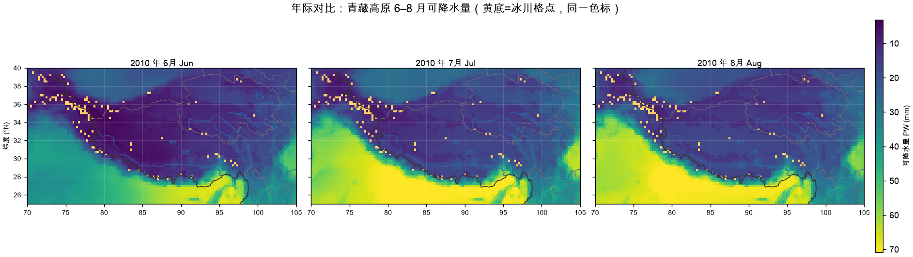
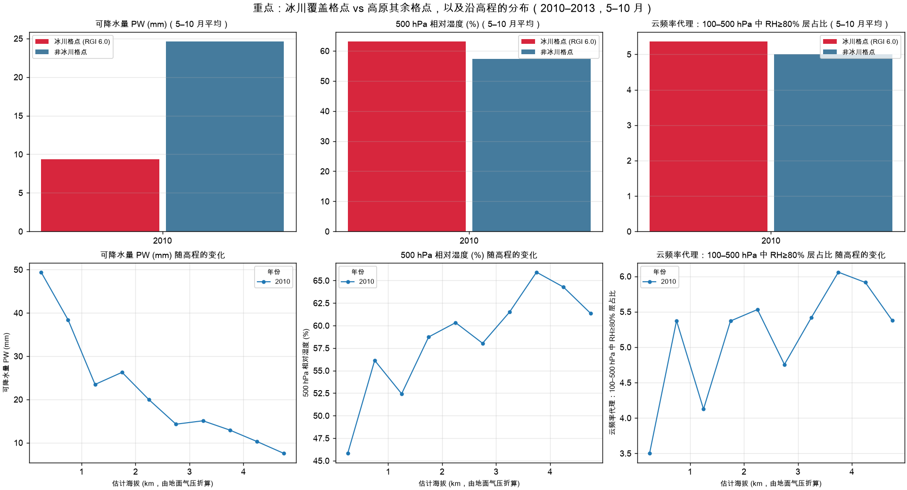
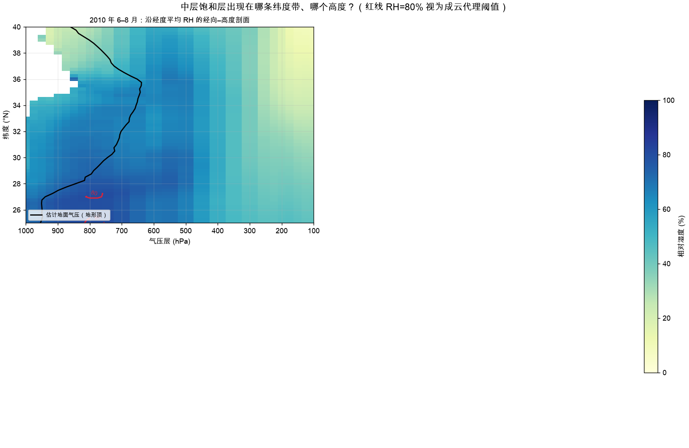
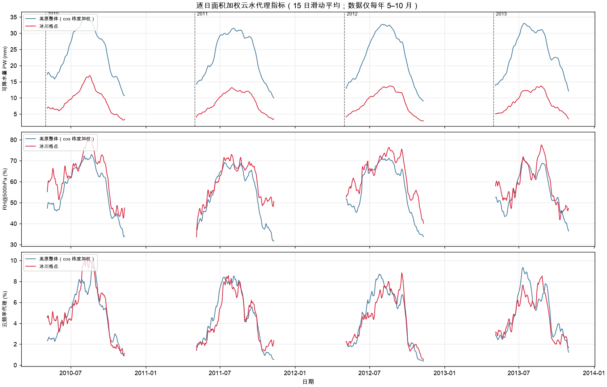

# Hydroweave 上手文档

> 面向接手这个仓库的人（包括三个月后的你自己）。读完这一篇，你应该能说清三件事：
> **这套代码在算什么、每个数字从哪来、结论能信到什么程度。**

- 仓库定位：把「青藏高原云水资源」拆成**可计算、可证伪**的模型，交付图与误差边界
- 本仓负责：数学模型 → 代码计算 → 误差分析 → 绘图出图（四项）
- 本仓不负责：数据获取与补齐（属数据侧 DBAS）
- 详细设计理由见 [README.md](../README.md)；本文是**操作手册 + 公式总账**

---

## 0. 三分钟了解这个仓库

### 0.1 一句话

**数据只有 `t`（温度）和 `q`（比湿），没有云水变量；但我仍然把云水资源问题做成了可计算、带误差边界的模型。**

### 0.2 为什么不能直接算「云水」

严格意义的云水资源需要云液水 `clwc`、云冰水 `ciwc`、云量等变量。当前 ERA5 卷只有
`t / q / u / v`，**缺云水变量**。面对这个约束，有两种错误做法：

| 错误做法 | 后果 |
|---|---|
| 假装能算，用可降水量（PW）代替云水 | 系统性高估数十倍，结论作废 |
| 把「等数据」写进待办 | 项目停摆，且掩盖了已能算的部分 |

本仓取第三条路：**先声明代理（proxy），再把代理算准，并把边界写清楚。**

### 0.3 两条并行的技术路线

```text
路线 A（数据到位即可跑）：代理指标链
    ERA5 t/q  →  PW / RH500 / CFRAC  →  EDA 规律  →  8 类图件
                 ↑ 已实现、已在 2010–2013 真实卷上验收

路线 B（模型已就绪，等云水数据）：收支模型链
    各水分项  →  收支方程  →  GCWR / 效率 / 更新周期  →  误差预算
                 ↑ 已实现、已用论文数值回归，纯代数层不依赖数据
```

**关键设计**：两条路线共享同一套口径约定（单位链、层序、地形掩膜、面积加权）。
云水数据到位时，路线 B 只需**替换输入**，不改模型结构。

### 0.4 判断仓库是否成立的三条标准

1. **公式写得出来** —— 每个量都有明确的数学定义与离散化方式，不是"调个库"
2. **误差算得清楚** —— 误差分层量化，方向已知，结论的适用边界明确
3. **结论经得起独立重算** —— 绕开实验代码、用另一条路径重算，结果一致

---

## 1. 快速开始

### 1.1 环境

```bash
cd ~/Desktop/Hydroweave
python3 -m venv .venv
.venv/bin/python -m pip install -e '.[dev]'
```

需要 Python ≥ 3.11。依赖分三组：

| 组 | 包 | 负责 |
|---|---|---|
| 数值与文件 | `numpy pandas xarray netCDF4` | 数组运算、表格、NetCDF 读写 |
| 分块并发 | `dask[array] flox` | 10 天一批流式处理，2 TB 卷不进内存 |
| 制图与配置 | `matplotlib pyshp PyYAML` | 出图、底图读取、配置解析 |

### 1.2 不碰外接盘的完整自检（推荐第一次就做这条）

合成数据自检**不需要**那 2 TB 外接卷，5 分钟内能跑通全链路：

```bash
# ① 生成自包含合成试验台（含 catalog、冰川掩膜、配置）
python3 scripts/demo/make_tp_cloud_water_fixture.py /tmp/tp_fixture --days 3

# ② 跑 EDA：输出逐日表、月平均场、manifest
PYTHONPATH=src:. python3 -m experiments.tp_cloud_water.eda \
    --config /tmp/tp_fixture/config.yaml --run-id fixture

# ③ 跑制图：输出 5 类图件 + EDA 摘要
PYTHONPATH=src:. python3 -m experiments.tp_cloud_water.plot \
    --config /tmp/tp_fixture/config.yaml --run-id fixture
```

跑完检查 `/tmp/tp_fixture/analysis/runs/fixture/`，应该看到：

```text
yearly/tp_monthly_2010.nc          月平均场（pw/rh500/cfrac/surf_p/rh_z）
tables/tp_daily.csv                逐日表（736 行 × 16 列，真实卷）
tables/tp_monthly.csv              逐月表
tables/tp_read_problems.csv        读取失败清单（不静默丢弃）
figures/fig_maps_2010.png          3 行 × 6 月空间分布
figures/fig_annual_comparison.png  年际对比（同一色标）
figures/fig_glacier_elevation.png  冰川 vs 非冰川 + 高程分层
figures/fig_timeseries.png         逐日时间序列
figures/fig_crosssection.png       经向–气压剖面
summary/tp_eda_summary.md          EDA 摘要
manifest.json                      运行清单（含每个产物的 SHA-256）
```

> **合成数据的数字没有物理意义**，它验证的是目录结构、清单机制、断点续跑与绘图链路。
> 想看真实结论，见 §1.3 或直接读 README §3.5。

### 1.3 真实卷运行

需要外接 ERA5 卷在线，且 catalog 已由数据层 DBAS 登记（本仓只读消费）。

```bash
PYTHONPATH=src:. python3 experiments/tp_cloud_water/eda.py \
    --config experiments/tp_cloud_water/config.yaml --run-id tp-2010-2013
PYTHONPATH=src:. python3 experiments/tp_cloud_water/plot.py \
    --config experiments/tp_cloud_water/config.yaml --run-id tp-2010-2013
```

⚠️ **`--run-id` 必须一致**：EDA 与制图用不同 run-id，图会配错场。
省略时默认取 `run-<config_hash>`，两边会自动一致。

### 1.4 三条验收命令（验证的是不同层次）

```bash
PYTHONPATH=src:. python3 -m pytest -q                    # 机制：38 passed, 9 skipped
PYTHONPATH=src:. python3 -m pytest -m real -q            # 真实数据契约（外接盘不在线则 skip）
python3 scripts/dev/validate_real_eda.py                 # 结论可信度（对抗性验收）
```

| 命令 | 验证什么 | 不通过意味着 | 注意 |
|---|---|---|---|
| `pytest -q` | 代码机制没坏 | 代码有 bug | 合成数据通过**不代表物理正确** |
| `pytest -m real` | 真实数据契约成立 | 数据侧或接口有问题 | 不在线时是 **NOT_RUN**，不是 PASS |
| `validate_real_eda.py` | 结论经得起重算 | 结论可疑 | 标准先定后用，不能事后调 |

---

## 2. 完整公式总账

**本节是全文的公式索引。** 每个公式都标注：含义、代码位置、来源依据。

### 2.0 符号约定（全文一致）

| 符号 | 含义 | 单位 |
|---|---|---|
| `q` | 比湿（水汽质量 / 湿空气质量） | kg·kg⁻¹ |
| `p` | 气压 | Pa（读入后由 hPa ×100） |
| `T` / `t_c` | 绝对温度 / 摄氏温度 `t_c = T − 273.15` | K / ℃ |
| `e` / `e_s` | 实际水汽压 / 饱和水汽压 | Pa |
| `φ` | 纬度 | ° |
| `g` | 重力加速度 | m·s⁻²，取 `9.80665` |
| `Qv` / `Qh` / `Qm` | 水汽 / 水凝物 / 总水物质 | kg |
| `GQx` | 各水物质的时段总量 | kg |
| `GCWR` | 空中留存云水量 | kg |

**单位链恒等式**：`1 kg·m⁻² 水柱 ≡ 1 mm` 水深。这是 `PW` 的积分结果能直接读作毫米的原因。

### 2.1 路线 A：代理指标（三个量的完整定义）

#### A-1 可降水量 PW —— 梯形垂直积分

```text
连续定义：  PW = (1/g) ∫ q dp                    [kg·m⁻² ≡ mm]
离散实现：  PW = Σ_i q_i · w_i / g
```

37 个气压层的梯形权重：

| 位置 | 权重 `w_i` |
|---|---|
| 顶层 (i=0) | `(p₁ − p₀)/2` |
| 中间层 | `(p_{i+1} − p_{i−1})/2` |
| 底层 (i=n−1) | `(p_{n−1} − p_{n−2})/2` |

- **代码**：[`eda.py::trapezoid_weights`](../experiments/tp_cloud_water/eda.py)、`compute_day`
- **来源**：可降水量标准定义
- **为什么用梯形**：37 层近地面间隔仅十几 hPa、高层可达上百 hPa，矩形累加在层厚突变处
  产生系统性偏差；梯形把误差降到二阶。不用指数坐标解析积分，因为那需要假设 `q` 随 `ln p`
  线性，而本卷近地面 `q` 变化剧烈，该假设不成立。

#### A-2 相对湿度 RH —— Magnus 经验公式

```text
水汽压：      e   = p · q / (0.622 + q)
饱和水汽压：  e_s = 611.2 · exp(17.67·t_c / (t_c + 243.5))     t_c 单位 ℃
相对湿度：    RH  = 100 · e / e_s            （裁剪到 [0, 300]%）
```

- **代码**：[`eda.py::compute_day`](../experiments/tp_cloud_water/eda.py)
- **来源**：Magnus/Tetens 公式，`0.622 = R_d/R_v`
- **关键取舍**：用**水面**系数（17.67/243.5），不是冰面（21.875/265.5）。
  - 后果：高原高空常 `< −20 ℃`，水面 `e_s` 偏大 → **RH 系统性偏低**
  - 影响方向：**单向偏低**，因此 CFRAC 数值应读作**下限**
  - 为什么不能简单地修：需要判相，而本卷没有 `clwc/ciwc` 可判相

#### A-3 地形掩膜 —— 等值连段几何判定

**这是本套数据最致命的口径陷阱。** ERA5 气压层文件中，地形以下的气压层被地面值填充，
**且不带缺测标记**。直接对 37 层积分，会把"岩石里的假空气"也算进 PW。

```text
判定相邻层相等：  |q[i+1] − q[i]| ≤ atol + rtol·|q[i]|      atol=1e-6, rtol=1e-3
自最底层向上累积求"连续相等"布尔链，链末端索引 ⇒ 地面层
地面层及以下 ⇒ 置 NaN，不计入积分
```

- **代码**：[`eda.py::sub_ground_mask`](../experiments/tp_cloud_water/eda.py)
- **为什么要容差 `rtol=1e-3`**：数据以 int16 打包存储，数学上相等的填充值解码后可能有末位差异，
  严格 `==` 会漏判。容差经真实数据标定：更小会漏判，更大会把真实弱梯度误判为填充。
- **副产品**：同时免费得到地面气压 `surf_p`，后续高程折算直接复用，无需额外变量。

#### A-4 云频率代理 CFRAC

```text
CFRAC = ( 100–500 hPa 内 RH ≥ RH_cloud 的层数 ) / ( 该层带内有效层数 )
默认 RH_cloud = 80%
```

- **代码**：[`eda.py::compute_day`](../experiments/tp_cloud_water/eda.py)
- **为什么分母用「有效层数」**：地形掩膜后每个格点剩余层数不同，用固定层数会让
  高原腹地（剩余层少）与边缘（剩余层多）不可比。
- **⚠️ 引用规则**：CFRAC 必须**连同阈值一起引用**，单独出现「5%」是无意义的。

#### A-5 面积加权 —— cos φ

```text
权重：      W(φ) = cos(φ) / Σ cos(φ)
区域均值：  <x> = Σ W·x / Σ W          （仅在有效格点上求和后归一化）
```

- **代码**：[`plot.py::wmean`](../experiments/tp_cloud_water/plot.py)
- **为什么必要**：高原窗口 25–40°N，纬度跨度导致格点面积不等。用简单算术平均会系统性
  高估高纬格点，偏差可达数个百分点，量级与年际差异相当，足以淹没真实信号。

#### A-6 高程折算 —— 标准大气反解

```text
z = 44330 · (1 − (sp / 1013.25)^0.1903)      sp 单位 hPa，z 单位 m
```

- **代码**：[`plot.py::fig_glacier_elevation`](../experiments/tp_cloud_water/plot.py)
- **适用性**：假设标准大气温度递减率。高原实际探空廓线与标准大气有差异，
  因此是**估计高程**——用于分层够用，用于精确海拔是错的。

### 2.2 路线 B：收支模型（云水资源的严格定义）

> 本节公式来自**蔡淼《中国空中云水资源和降水效率的评估研究》第 2 章**，
> 逐条对照原文核对。实现在 [`budget.py`](../experiments/tp_cloud_water/budget.py)。

#### B-0 控制体定义（最重要的一步）

```text
控制体 Ω = 区域 (X,Y) × 自地面到对流层顶 (Z)
时段     = [t0, t1]，时长 T
```

**所有分项都是该控制体内该时段的累计质量（kg），不是某一时刻的柱含量。**

> 这是与 PW 最根本的区别：**PW 是瞬时储量，GCWR 是收支余量。**
> 把柱云液水当作 GCWR，是把"库存"当成了"流水结余"。

#### B-1 三条收支方程（论文式 1–3）

```text
水汽：    Qv,终 − Qv,初 = Qv,入 − Qv,出 + 地面蒸发 − 净凝结        (1)
水凝物：  Qh,终 − Qh,初 = Qh,入 − Qh,出 − 降水   + 净凝结        (2)
总物质：  Qm,终 − Qm,初 = Qm,入 − Qm,出 + 地面蒸发 − 降水        (3)
```

**物理读法**：
- 水汽：由输送与蒸发补给，因凝结减少
- 水凝物：由凝结形成，因输送与降水离开
- 总物质：相变项相互抵消，只剩输送、蒸发、降水

三式中只有**净凝结**与**地面蒸发**是未知量，其余都能从三维场和风场算出。

#### B-2 反算（论文式 10–12）

```text
净凝结  C_net = Qh,终 − Qh,初 − Qh,入 + Qh,出 + 降水              (10)
地面蒸发 E     = Qv,终 − Qv,初 − Qv,入 + Qv,出 + C_net             (11)
地面蒸发 E     = Qm,终 − Qm,初 − Qm,入 + Qm,出 + 降水              (12)
```

- **代码**：`budget.py::net_condensation` / `evaporation_from_vapor` / `evaporation_from_total`
- **用法**：(11) 与 (12) 应大致相符，其**差异本身就是收支闭合的检查指标**。

#### B-3 总量（论文式 13–15）

```text
GQv = Qv,初 + Qv,入 + E     = Qv,终 + Qv,出 + C_net              (13)
GQh = Qh,初 + Qh,入 + C_net = Qh,终 + Qh,出 + 降水                (14)
GQm = Qm,初 + Qm,入 + E     = Qm,终 + Qm,出 + 降水                (15)
```

> 🚨 **本仓踩过的最大的坑**：论文式 (16) `GQm = GQv + GQh` 说的是**瞬时库存**关系。
> 在**累计通量**下它**不成立**——净凝结在 `GQv` 里是汇、在 `GQh` 里是源，二者相加会
> **重复计入一次**。实测按 `GQv + GQh` 算 `GQm` 会高估约 **60%**。
>
> 正确关系：`GQm = GQv + GQh − C_net`，且 `GQm` 必须走式 (15) 独立核算。
> 已由测试 `test_cumulative_gqm_is_not_sum_of_gqv_and_gqh` 锁死。

#### B-4 效率与更新周期（论文式 17–19）

```text
总水物质降水效率  Em = 降水总量 / GQm                            (17)
水凝物降水效率    Eh = 降水总量 / GQh
水汽凝结效率      P  = 总凝结量 / GQv                            (18)

水汽更新周期      Tv = Qv,平均 / (降水总量 / T)                   (19)
水凝物更新周期    Th = Qh,平均 / (降水总量 / T)
```

- **代码**：`budget.py::efficiency` / `renewal_period`
- **口径警告**：(18) 的「总凝结量」与 (10) 反算的「净凝结量」**不是同一个量**，
  资料只能给净凝结时不得直接替换。
- **分母为 0 或缺失时返回 `NaN`，绝不返回 `inf`**（论文明确要求）。
- **论文 2011 年全国实测参照值**：`Tv ≈ 11 天`、`Th ≈ 15 小时`、`Em ≈ 18%`、
  `Eh ≈ 77%`、`P ≈ 23%`。

#### B-5 GCWR —— 核心指标（论文式 20–22）

```text
GCWR = GQh − 降水                        (20)  原始定义
     = Qh,终 + Qh,出                     (21)  终端核算
     = Qh,初 + Qh,入 + C_net − 降水       (22)  初始核算
```

- **代码**：`budget.py::gcwr`，返回三值与极差 `spread`
- **必须同时算三种写法并交叉核对**：`spread` 正常应为机器精度量级；
  显著不为零说明各分项口径不一致。
- **论文 2011 年全国实测**：水凝物总量约 8.48 万亿吨，地面降水约 6.58 万亿吨，
  **GCWR ≈ 1.9 万亿吨**。

> ⚠️ **GCWR 的边界必须一起说**：它只是云水资源的**粗估**。其中只有一部分具备
> 人工增雨技术开发条件——例如云底很高、云下很干的云层，降水粒子下落途中就蒸发了，
> 落地率为零。**GCWR ≠ 可开发水资源。**

#### B-6 边界平流（论文 §2.2）

```text
带符号质量：  ΔM = ρ · q · u_n · ΔS · Δt        u_n 以指向控制体外为正    (23)
输出：        GQx,out = Σ max(ΔM, 0)                                      (24)
输入：        GQx,in  = Σ max(−ΔM, 0)                                     (25)
```

- **代码**：`budget.py::boundary_signed_mass` / `boundary_flux_mass`
- **三条实现注意**：
  1. 四个边界的外法向不同，必须用风矢量与法向点乘定符号，**不能凭风向名称判断**
  2. 气压层间隔**不能**直接当几何层厚，需按资料定义算层质量
  3. 离散冰川像元的边界远比矩形复杂，控制体定义须先明确

#### B-7 降水累计与单位换算

```text
1 mm = 1 kg·m⁻²
GR = Σ_i Σ_n M_i · P_{i,n} · A_i                    P 单位 mm      (26)
GR = Σ_i Σ_n M_i · r_{i,n} · A_i · Δt_n             r 单位 kg·m⁻²·s⁻¹ (27)
```

- **代码**：`budget.py::rain_mass_from_mm` / `rain_mass_from_rate`
- **🚨 再分析降水陷阱**：「自预报起点累计」的降水变量是**累积值**，
  每个时次的值不能直接相加，必须先差分还原单步降水。
  遇到负差分先查累计周期重置，**不得直接置零**。

### 2.3 公式速查表

| 编号 | 公式 | 代码位置 | 来源 |
|---|---|---|---|
| A-1 | `PW = Σ q_i w_i / g` | `eda.py::trapezoid_weights` | 标准定义 |
| A-2 | `RH = 100·e/e_s`（Magnus 水面） | `eda.py::compute_day` | Magnus/Tetens |
| A-3 | 等值连段掩膜 `|Δq| ≤ atol + rtol·|q|` | `eda.py::sub_ground_mask` | 本仓标定 |
| A-4 | `CFRAC = n(RH≥80% 层) / n(有效层)` | `eda.py::compute_day` | 阈值代理 |
| A-5 | `W(φ) = cos φ / Σ cos φ` | `plot.py::wmean` | 球面加权 |
| A-6 | `z = 44330(1 − (sp/1013.25)^0.1903)` | `plot.py` | 标准大气 |
| (1)(2)(3) | 三条收支方程 | `budget.py` | 蔡淼式 1–3 |
| (10)(11)(12) | 净凝结 / 蒸发反算 | `budget.py::net_condensation` 等 | 蔡淼式 10–12 |
| (13)(14)(15) | 各水物质总量 | `budget.py::totals` | 蔡淼式 13–15 |
| (17)(18)(19) | 效率 / 更新周期 | `budget.py::efficiency` `renewal_period` | 蔡淼式 17–19 |
| (20)(21)(22) | GCWR 三种写法 | `budget.py::gcwr` | 蔡淼式 20–22 |
| (23)(24)(25) | 边界平流 max 分解 | `budget.py::boundary_flux_mass` | 蔡淼 §2.2 |
| (26)(27) | 降水质量累计 | `budget.py::rain_mass_from_mm` | 单位链 |
| (30)(31)(32) | 收支残差 | `budget.py::residuals` | 闭合检验 |

---

## 3. 误差分析：三层拆解

> **不要笼统说"误差 5%"** —— 那是没有信息量的。误差必须分层，每层说清来源与量化方式。

### 3.1 第一层：数值误差（可精确度量）

| 来源 | 控制手段 | 实测结果 |
|---|---|---|
| 垂直积分离散化 | 梯形权重而非矩形 | 二阶精度 |
| 单格点计算实现 | **绕开实验代码**，直接读原始 NetCDF 手工重算 | 4 个单柱，相对误差 **0.0000%** |
| 变量与时间对齐 | 显式按 UTC 时次筛选，q/t 严格配对 | 736 天全部配对 |
| 区域平均 | cos φ 面积加权 | 见 A-5 |

**独立重算是关键**：`validate_real_eda.py::_manual_pw_column` 不复用 `eda.py` 任何函数，
自己实现掩膜与积分。二者一致 ⇒ 实现正确。
但这**不能证明物理口径正确**——口径正确性只能靠观测对照（见 3.3）。

### 3.2 第二层：口径误差（最容易忽略、影响最大）

| 误差源 | 方向 | 量级证据 |
|---|---|---|
| 地形以下填充层未剔除 | **显著高估** | 填充层占比实测 **21.7%**（四年恒定） |
| Magnus 用「水面」而非「冰面」 | 高空 RH **偏低** | 与 `t < −20℃` 层数成正比 |
| 时次等权代替日均 | 未量化 | 用 00/06/12/18 UTC 四时次，未加权 |
| 用 RH 阈值代理云频 | 阈值敏感 | 80% 一处取值决定全部数值 |

**第一行的量级值得单独强调**：地下填充层稳定占 **21.7%**，意味着不做掩膜，PW 会被
系统性高估约五分之一——**这个误差比所有数值误差加起来大三个数量级**。
这就是为什么 A-3 的几何判定必须精确到容差标定。

### 3.3 第三层：代理误差（方向已知、不可标定）

性质要说清：这**不是待修的 bug，也不是待补的缺口**，而是当前数据条件下**已界定的误差边界**。
误差分析的完成态不是"把误差降到零"，而是**说清方向与结论是否受影响**。

| 代理量 | 与真实物理量的关系 | 偏差方向 | 结论怎么用 |
|---|---|---|---|
| PW | 水汽柱总量 ≠ 云水量 | **系统性高估**云水资源 | 只作资源上限 |
| RH500 | 中层湿度 ≠ 成云发生 | 受 A-2 影响**单向偏低** | 保守估计，不夸大 |
| CFRAC | 阈值统计 ≠ 云频率 | 由 RH 派生，**单向偏低** | 绝对量级读作下限；相对比较不受影响 |

**关键判据**：偏差方向已知，就能回答"结论会不会因此反转"。
年际/月际的**相对差异**不受系统性偏差影响（偏差对各年同向同量作用），可直接引用；
**绝对量级**必须连同上/下限一起说。

> **因此 GCWR 的判定是 `INSUFFICIENT_EVIDENCE`，而不是"近似 PASS"。**
> 当一个量的误差连方向都给不出时，报"不知道"比报一个数更有价值。

### 3.4 GCWR 的误差分析：一阶传播

代理量的误差结构是"乘性偏差"；GCWR 进入收支模型后，它是若干分项的**线性组合**，
因此**一阶（高斯）误差传播精确成立**，不需要蒙特卡洛。

由式 (21) `GCWR = Qh,终 + Qh,出`，偏导只有两个非零：

```text
∂GCWR/∂Qh,终 = 1        ∂GCWR/∂Qh,出 = 1        其余各项偏导 = 0
σ²_GCWR = σ²(Qh,终) + σ²(Qh,出)                （独立假设）
```

#### 一个反直觉但关键的结论

**降水、`Qh,初`、`Qh,入` 的观测误差对 GCWR 一阶无影响。**

因为：初值与输入在净凝结的反算中被完全吸收，降水在式 (22) 中一正一负抵消。

> **行动含义**：**改进降水观测不会降低 GCWR 的不确定度。**
> 降低它只能靠测准**水凝物场末值**和**边界输出**。
> 这条结论直接决定后续攻关优先级——这就是"误差分析结论必须能改变行动"。

#### 口径误差的乘性传播

```text
σ_rel = sqrt( Σ f_i² )        f_i 为第 i 个口径误差的相对 1σ
```

方向一致的因子可合并成单向偏差；**方向相反的因子（掩膜致高估 + Magnus 致低估）
只能报区间，不能断言"偏高"或"偏低"**——代码 `apply_calibration` 强制这个区分。

#### 判定阈值（先定后用）

| 相对 1σ | 判定 | 含义 |
|---|---|---|
| < 20% | `CONCLUSIVE` | 可支撑定量结论 |
| 20% – 50% | `CONDITIONAL` | 只支撑相对/定性结论 |
| ≥ 50% | `INSUFFICIENT_EVIDENCE` | 只能报区间，不能断言大小 |

> 该模块**不提供默认不确定度**——所有 σ 必须由调用方显式给定，
> 防止把"没评估"静默变成"误差为零"。

### 3.5 验收标准全表

**标准预先硬编码在脚本里（`STANDARDS`），防止事后按结果调整。**

| 编号 | 标准 | 判定 |
|---|---|---|
| S1 | catalog 记录的 1472 个 q/t 文件在盘上全部存在、大小一致 | PASS |
| S2 | 每年 5-1～10-31 恰好 184 天，q/t 成对 | PASS（736 天） |
| S3 | 抽样 12 天物理量在量级内 | PASS |
| S4 | 独立手工重算单柱 PW，相对误差 ≤0.5% | PASS（**0.0000%**） |
| S5 | 与旧实现产物逐比特一致 | PASS（16 组 max abs diff = 0） |
| S6 | manifest、736 行逐日表、8 张图、摘要齐全 | PASS |
| S7 | GCWR 三种写法极差 ≤ 1e-9×量级 | 单元测试锁死 |
| S8 | 累计 `GQm` **不得**等于 `GQv + GQh` | 单元测试锁死 |
| S9 | 库存关系 `Qm = Qv + Qh` 在初末成立 | 单元测试锁死 |
| S10 | 边界通量 `输出 − 输入 = Σ带符号通量` | 单元测试锁死 |

**判定口径**：全部硬标准 PASS → `PASS`；仅因历史产物缺失导致 S5/S6 NOT_RUN →
`CONDITIONAL_PASS`；任一硬标准 FAIL → `FAIL`。

**最终判定：PASS**（2026-11-03 实测）。

### 3.6 验收覆盖不到的剩余风险（必须一并声明）

- S5 的"逐比特一致"证明新旧实现等价，但**两者共用同一物理口径**，不能证明口径本身正确
- 抽样日只覆盖 12 天（每月中旬），**未覆盖全部 736 天**，极端天气个案未单独检查
- 真实卷为只读挂载，**损坏文件场景未测试**
- 未做全量 NetCDF 逐字节校验（属数据层职责）

> 上述都属于**本仓实现与验证手段**的已知局限，已明确列出，不掩盖、不声称已解决。

---

## 4. 实验规范

### 4.1 唯一配置入口

所有实验口径由 [`config.yaml`](../experiments/tp_cloud_water/config.yaml) 决定，代码里没有机器专属路径。

| 配置项 | 含义 | 默认值 |
|---|---|---|
| `region` | 区域范围 | 25–40°N / 70–105°E |
| `years` | 年份列表 | 2010–2013 |
| `synoptic_hours` | 参与日均的 UTC 时次 | `[0, 6, 12, 18]` |
| `pressure_band_hpa` | CFRAC 统计层带 | `[100, 500]` |
| `rh_cloud_pct` | 成云阈值 | `80.0` |
| `batch_days` / `workers` | 分块天数 / 线程数 | 10 / 2 |
| `glacier_mask` | 冰川掩膜路径 | `.../glacier_mask_025.npz` |
| `basemap_dir` | 底图 shp 目录（可空） | 见配置 |

**改配置 = 改口径**，改完会被 `config_hash` 捕获，不允许新口径产物覆盖旧口径。

### 4.2 运行命名与隔离

- 产物全部落在 `data/analysis/<experiment>/runs/<run_id>/`，不散落
- `run_id` 省略时取 `run-<config_hash>`
- **配置哈希或输入指纹变化时，同一 `run_id` 直接报错**——必须换 `--run-id` 或显式 `--force`
- 这防止两套口径的产物静默覆盖，是"结论可信"的底层保险

### 4.3 可复现契约

`manifest.json` 记录：

| 字段 | 内容 |
|---|---|
| `config_hash` | 配置哈希 |
| `input_fingerprint` | 卷 ID + 相对路径 + 大小 + mtime |
| `git_revision` | 代码版本 |
| `packages` / `python` / `platform` | 运行环境 |
| `completed_years` / `failed_dates` | 完成年份、失败日期 |
| `artifacts[]` | **每个产物的 SHA-256 与字节数** |

**断点续跑**：年度产物先写 `.part` 再原子替换，已完成年份直接跳过；
个别日期失败记入 `tp_read_problems_<year>.csv` 并汇总到 `failed_dates`，**不静默丢弃**。

> **复现边界**：输入指纹是**逻辑指纹**（路径+大小+mtime），不是比特级 SHA-256。
> 需要比特级归档证据时由数据层 `dbas checksum` 生成；一个 manifest 不能冒充物理验证。

### 4.4 代码分层：一文件一职责

```text
experiments/          「算什么」—— 数学口径与计算
  eda.py              代理指标：柱积分、RH、掩膜、面积加权、断点续跑
  budget.py           收支模型：式(1)-(32) 的代数实现
  error_analysis.py   GCWR 误差：一阶传播、口径因子、误差预算、判定
  plot.py             规律与出图
  common.py           配置、catalog、run 目录

src/hydroweave/repro/ 「凭什么可信」—— 可复现契约
  manifest.py         哈希、指纹、原子写

scripts/dev/          「谁来验」—— 独立验收
  validate_real_eda.py

scripts/demo/         合成试验台（不依赖外接盘）
tests/                测试
```

**三者分离的目的**：让验证方不依赖被验证方——`validate_real_eda.py` 刻意**不复用**
`eda.py` 的计算函数，只用它做配置解析与网格裁切这类无口径争议的操作。

### 4.5 写代码前的四条硬规矩

1. **先做单元测试再跑真实资料**——边界风向、收支代数、GCWR 三式一致性，用少量手算数字验
2. **任何算不出的项都明确标记**——不能用柱水汽量、云冰量或云液水量替代
3. **保留中间结果**——每项的单位、缺测标记和收支残差，不要只存最终 GCWR
4. **不允许为让方程闭合而静默改数据**

### 4.6 新增实验的标准动作

```text
① 在 config.yaml 加参数（不硬编码）
② 在 eda.py / budget.py 实现口径，注明公式编号与来源
③ 在 tests/ 加单元测试（含边界情况与反例）
④ 跑合成数据全链路，确认产物与 manifest 正常
⑤ 跑真实卷，更新验收标准
⑥ 在 README 对应章节补公式与理由
```

---

## 5. 绘图与报告

### 5.1 图件清单（共 8 张）

| 图件 | 内容 | 回答什么问题 |
|---|---|---|
| `fig_maps_<年>.png` | 3 行(PW/RH500/CFRAC) × 6 列(5–10 月) | 空间分布形态、季节推进 |
| `fig_annual_comparison.png` | 6–8 月年际对比，**同一色标** | 年际是否有可辨信号 |
| `fig_glacier_elevation.png` | 冰川 vs 非冰川 + 沿高程分布 | 冰川区是否水汽富集 |
| `fig_timeseries.png` | 逐日时间序列 | 天气尺度事件、数据断档 |
| `fig_crosssection.png` | 经向–气压剖面 | 云在哪个高度、哪条纬度带 |



*年际对比：同一色标跨年绘制，避免"颜色变深"只是换了量程。*



*上排：冰川格点 vs 非冰川格点；下排：沿估计高程的变化（500 m 分层，每档要求 ≥30 个有效格点）。*



*经向–气压剖面：红线为 RH=80% 成云代理阈值，黑线为地面气压折算的地形顶。地形以下一律不画。*



*逐日时间序列：15 日滑动平均后仍可见明显过程起伏。*

### 5.2 绘图规范（照做，别自创）

**配色与量程**
- 固定三色板：PW `viridis`、RH500 `YlGnBu`、CFRAC `magma`
- **色标跨年份共用**：否则"某年颜色变深"可能只是换了量程
- 量程用**全局 1%–99% 分位**定界，不从 0 起——否则高原内部差异会被压成一片同色

**地理投影**
- `aspect = 1/cos(φ_mean)`，避免纬度拉伸失真
- 冰川格点用金色 `#ffd166` 叠加，不遮挡底层场
- 底图（1:4,000,000 中国边界/水系 shp）**只作地理参照，不做分析输入**；不在线时自动跳过

**地形处理**
- 剖面图中地形顶以下**一律不画**——保证出现的每一层都是真实大气

**技术参数**
- DPI = 130，`constrained_layout=True`
- 中文字体按 `PingFang SC → Heiti SC → Hiragino Sans GB → Arial Unicode MS` 逐级回退
- `axes.unicode_minus = False`（避免负号变方块）

**小样本保护**
- 高程分层每档要求 **≥30 个有效格点**才出图，避免小样本噪声被当成规律
- 某年缺月份时留白且不画刻度，不留空面板

### 5.3 出图命令

```bash
PYTHONPATH=src:. python3 -m experiments.tp_cloud_water.plot \
    --config experiments/tp_cloud_water/config.yaml --run-id tp-2010-2013
```

图件写回同一 run 目录的 `figures/`，摘要写回 `summary/tp_eda_summary.md`。
换 `--run-id` 即可让 EDA 与制图产物成组隔离，不会互相覆盖。

### 5.4 报告结构（summary 自动生成）

`summary/tp_eda_summary.md` 固定包含：

1. **为什么是代理指标**——先把边界说清，不让读者误以为这是真云水
2. **逐年 5–10 月平均**表
3. **逐月多年平均**表
4. 数据质量（地下填充层占比、失败日期）
5. 图件索引

**报告的写法要求**：结论按证据强度分级——
- **数据事实**（可直接引用）
- **观察事实 + 机制待验证**（提示但不结论）
- **证据不足**（明确写"不知道"）

### 5.5 GCWR 报告的额外要求

一旦进入收支模型，报告必须包含（论文 §3 要求）：

| 必报项 | 说明 |
|---|---|
| 区域、起止时间 | 控制体定义 |
| 初末水汽/水凝物存量 | 瞬时值 |
| 水汽/水凝物输入输出 | 边界累计 |
| 降水总量、净凝结量、地面蒸发量 | 反算项 |
| `GQv` `GQh` `GQm` `GCWR` | 总量与核心指标 |
| `Em` `Eh` `Tv` `Th` | 效率与周期 |
| 各收支残差 | 闭合检验 |
| 数据质量标记 | 可追溯性 |

**同时报告区域总量（kg 或吨）与单位面积量（kg·m⁻²），并注明时间窗口。**

---

## 6. 已经得到什么结论

> 以下来自 2010–2013 真实卷（784 天暖季），全部可复现。按证据强度分级。

### 6.1 直接可用：2010–2013 暖季实测（多年平均）

| 月份 | PW (mm) | 冰川区 PW (mm) | RH500 (%) | CFRAC (%) |
|---|---|---|---|---|
| 5 月 | 16.6 | 5.9 | 47.0 | 2.6 |
| 6 月 | 24.9 | 8.8 | 59.9 | 5.3 |
| 7 月 | 31.7 | 12.3 | 68.3 | 7.9 |
| 8 月 | 30.9 | 13.2 | 67.1 | 6.9 |
| 9 月 | 24.3 | 9.1 | 57.3 | 4.7 |
| 10 月 | 14.2 | 4.4 | 39.7 | 1.7 |

### 6.2 三条规律（按证据强度）

**① 季节形态单峰、峰值在盛夏** —— *数据事实，可直接引用*
PW 与 CFRAC 同步在 7–8 月达峰，与季风水汽输送窗口时间吻合；
RH500 的峰更早更平缓，即中层饱和对季节的响应弱于整层水汽。
⚠️ "吻合"不等于"因果"，因果需等收支与环流诊断。

**② CFRAC 量级小、年际稳定** —— *数据事实*
年际 4.7–5.0%（极差 0.3 个百分点），月际 1.7–7.9%。
由于 RH 被单向压低，这些数值应读作**下限**；但"年际差异小"这一**相对**判断不受影响。
⚠️ 仅 4 年样本，**不足以支持任何趋势判断**。

**③ 冰川区 PW 只有高原整体的约 1/3** —— *观察事实，机制待验*

| 年份 | 高原整体 PW | 冰川区 PW | 非冰川 PW |
|---|---|---|---|
| 2010 | 24.4 | 9.4 | 24.6 |
| 2011 | 23.6 | 8.8 | 23.8 |
| 2012 | 23.2 | 8.9 | 23.4 |
| 2013 | 23.9 | 8.8 | 24.1 |

**这与"冰川区 = 水汽富集区"的朴素直觉相反**，且四年方向稳定。
候选解释（海拔剪短水汽柱、地形阻挡输送）**尚未经收支分析证实**——证据不足的机制不写成结论。
可以确立的是：**水汽来源不能由 PW 场直接推断，必须另做水汽收支。**

> 这也解释了为什么必须做地形掩膜：若不剔除地形以下填充层，冰川格点（地形最深）会被人为
> 加上大量假水汽，**恰好把这个真实信号抹平**。

### 6.3 尚未成立：GCWR

**当前判定：`INSUFFICIENT_EVIDENCE`。**

原因：本卷缺 `clwc/ciwc`，水凝物三维场无法构造。
模型已就绪（路线 B），数据到位即可接上。

---

## 7. 把这个仓库讲给别人听

### 7.1 90 秒版本

> 青藏高原云水资源研究通常需要云水含量数据，但我手上的 ERA5 卷只有温度和比湿。
> 我没有等数据，也没有用可降水量冒充云水，而是做了两件事：
>
> **第一**，在现有数据上构造三个**有明确物理含义的代理量**——可降水量、中层饱和、
> 云发生频率代理——把每个的数学定义、离散化方式、已知偏差方向全部写清楚，
> 在 2010–2013 年真实数据上跑通，并用一条**独立于实验代码的路径**重算验证（相对误差 0.0000%）。
>
> **第二**，把严格云水资源的收支模型**完整实现好**（依据蔡淼博士论文第 2 章），
> 包括三条收支方程、GCWR 三种等价写法、效率与更新周期，并用论文报告的真实数值做回归验证。
> 模型是纯代数层，**不依赖任何数据**，云水数据一到就能接上。
>
> 关键成果不是某个数字，而是**误差边界**：哪些结论可以直接引用（季节形态）、
> 哪些只能作相对比较（年际差异）、哪些必须说"不知道"（GCWR、冰川区机制）。

### 7.2 可能会被问到的三个问题

**Q：为什么不用机器学习直接预测云水？**
A：没有云水标签就没有监督信号。当前数据连"真值"都没有，用代理量训练只会拟合代理量的偏差。

**Q：地形掩膜真的那么重要？**
A：填充层占 21.7%，不做掩膜 PW 高估约 1/5——**比所有数值误差大三个数量级**，
而且会把冰川区"水汽少"这个真实信号整个抹掉。

**Q：为什么说 GCWR 是"证据不足"而不是"接近正确"？**
A：因为它依赖水凝物三维场，而本卷没有。误差连**方向**都给不出时，报"不知道"比报一个数更有价值——
这正是误差分析的职责。

### 7.3 贡献边界（不夸大）

**做了的**：模型与公式实现、真实数据计算、三层误差分析、8 类图件、可复现契约、独立验收。

**没做的**：数据获取与补齐、比特级数据校验、水汽来源追踪（属另一框架）。

**为什么这样分**：数据变量是否齐备由数据侧决定。本仓的做法是**在给定变量约束下
把能算的算准、把算不了的边界标清**，而不是把"等数据"写进开发计划。

---

## 8. 下一步（不依赖新数据）

三项都属于模型实现与误差分析的深化，**接口已现成，改配置即可跑**：

1. **时次加权敏感性**：当前 00/06/12/18 UTC 等权近似日均，改为按小时角权重或全时次对照，
   量化"时次等权"这一未量化的口径误差。*入口*：`synoptic_hours`
2. **阈值不确定带**：`RH_cloud` 在 60–90% 扫描，输出 CFRAC 区间而非单值，
   使"阈值取多少"从隐含假设变成显式敏感性结论。*入口*：`rh_cloud_pct`
3. **掩膜容差自检**：`rtol` 在 1e-4～1e-2 扫描，报告填充层占比与 PW 的响应曲线，
   把"容差取 1e-3"从经验取值变成有依据的标定。*入口*：`sub_ground_mask(..., rtol=)`

### 等数据到位后可做

- 水凝物三维场构造 → 接上 `budget.py` → 输出 GCWR
- 边界通量（需 `u/v` 与水凝物场）→ 完成收支闭合
- 冰川区控制体定义（离散像元，边界远比矩形复杂，须先明确）

---

## 附：一页速查

```bash
# 环境
python3 -m venv .venv && .venv/bin/python -m pip install -e '.[dev]'

# 自检（不碰外接盘）
python3 scripts/demo/make_tp_cloud_water_fixture.py /tmp/tp_fixture --days 3
PYTHONPATH=src:. python3 -m experiments.tp_cloud_water.eda  --config /tmp/tp_fixture/config.yaml --run-id fixture
PYTHONPATH=src:. python3 -m experiments.tp_cloud_water.plot --config /tmp/tp_fixture/config.yaml --run-id fixture

# 真实卷
PYTHONPATH=src:. python3 experiments/tp_cloud_water/eda.py  --config experiments/tp_cloud_water/config.yaml --run-id tp-2010-2013
PYTHONPATH=src:. python3 experiments/tp_cloud_water/plot.py --config experiments/tp_cloud_water/config.yaml --run-id tp-2010-2013

# 验收三层
PYTHONPATH=src:. python3 -m pytest -q                # 机制
PYTHONPATH=src:. python3 -m pytest -m real -q        # 真实数据契约
python3 scripts/dev/validate_real_eda.py             # 结论可信度

# 收支模型（不依赖数据）
PYTHONPATH=src:. python3 -m pytest tests/test_cloud_water_budget.py -q   # 26 项
```

| 想知道 | 去看 |
|---|---|
| 某个量的数学定义 | 本文 §2 + [README §1](../README.md) |
| 为什么这么设计 | [README](../README.md) 各节「为什么」段落 |
| 结论能信多少 | 本文 §3、§6 |
| 代码在哪 | 本文 §4.4 |
| 图表怎么出 | 本文 §5 |
| 验收是否通过 | `data/analysis/.../validation/real_eda_check.md` |
